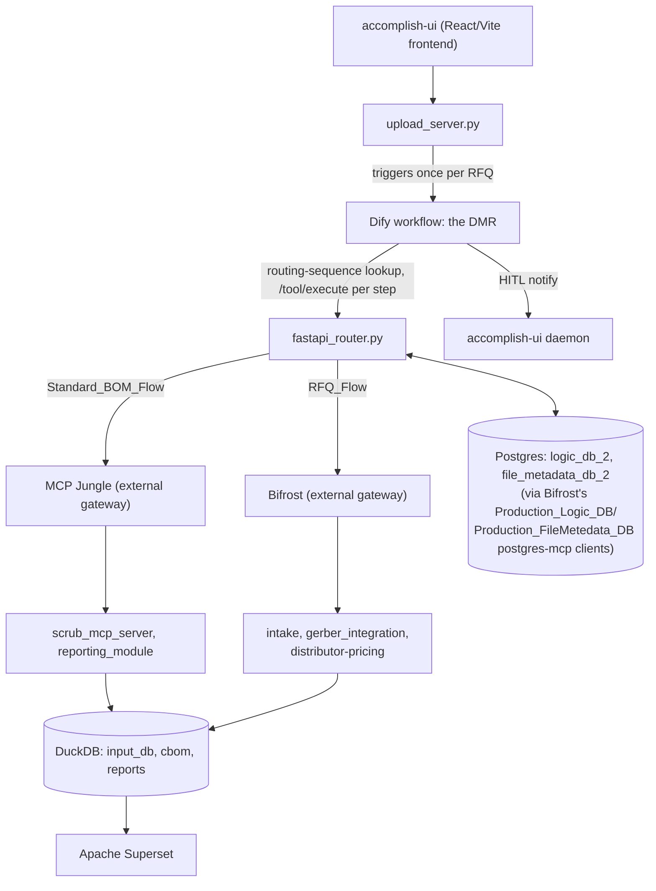

# CLAUDE.md

This file is meant to let a future Claude session (or any new engineer)
understand this platform's complete architecture without re-investigating
the repository from scratch. Read this first; go to the linked documents
for depth.

> **Note:** a copy of this file also lives at the repo root as `CLAUDE.md`
> (with links adjusted to the `docs/` prefix) so Claude Code auto-loads it
> on startup. If you update this file, regenerate the root copy too by
> running `scripts/sync-claude-md.sh` from the repo root.

## ⚠️ Documentation Maintenance Policy — read this before making ANY code change

**This documentation set must be kept in sync with the code. Docs going
stale is exactly the failure mode this whole effort was built to prevent
— do not let it happen silently.**

**The rule**: any commit/change that alters behavior, adds/removes a
file, changes an API, a database schema, a routing sequence, or an
architectural fact stated in these docs MUST update the corresponding
documentation in the same change, not as a follow-up "someday" task.

**How to find what needs updating** — match the change to its doc:

| If you changed... | Update... |
|---|---|
| Any `.py` file in `centum intake\` root | [Backend/file-reference.md](./docs/Backend/file-reference.md) (that file's section) |
| Any `.py` file in `reporting_module\` (incl. `reports/`, `templates/`) | [Reporting/reporting-module.md](./docs/Reporting/reporting-module.md) |
| Any file in the `intake`, `distributor_pricing`, or `gerber_integration` tool servers (live, registered in Bifrost, serving `RFQ_Flow`) | [MCP/intake-tool-reference.md](./docs/MCP/intake-tool-reference.md) or [MCP/distributor-pricing-tool-reference.md](./docs/MCP/distributor-pricing-tool-reference.md) |
| A new/removed/renamed MCP tool, or a change to which server is live vs. dormant | [MCP/fastmcp-tools.md](./docs/MCP/fastmcp-tools.md) |
| Anything about MCP Jungle's integration contract (URL, protocol, session handshake) — Standard_BOM_Flow only | [MCP/mcp-jungle.md](./docs/MCP/mcp-jungle.md) |
| Anything about Bifrost's integration contract (URL, protocol, tool naming) — RFQ_Flow only | [MCP/bifrost.md](./docs/MCP/bifrost.md) |
| A new/changed HTTP endpoint on any service | [APIs/endpoints.md](./docs/APIs/endpoints.md) |
| A Postgres table/column in `logic_db`/`file_metadata_db`, a routing profile, or a skill registry row | [Database/logic-database.md](./docs/Database/logic-database.md) — re-run the live `information_schema` introspection, don't guess |
| The Dify workflow itself (re-exported `.yml`) | [DMR/dynamic-master-router.md](./docs/DMR/dynamic-master-router.md) — re-derive from the fresh export, node by node, the same way this doc was originally built |
| `manage_backend.py`'s service list, ports, or startup mechanics | [Backend/overview.md](./docs/Backend/overview.md) and [Deployment/deployment.md](./docs/Deployment/deployment.md) |
| Anything in `accomplish-ui` relevant to this platform's integration points | [Frontend/accomplish-ui.md](./docs/Frontend/accomplish-ui.md) |
| A new term/concept introduced anywhere above | [Reference/glossary.md](./docs/Reference/glossary.md) |
| Any change significant enough to affect the platform-wide summary, the folder map, the request flow, or the extension guide | **This file** (`CLAUDE_CONTEXT.md`) — then regenerate root `CLAUDE.md` per the note above |

**If something you fixed was previously documented as a known gap or
limitation** (e.g. the SQL-injection surface in `fastapi_router.py`, the
hardcoded credentials, the missing multi-project isolation, the
`reporting_module` DB-path caveat) — **remove or update that specific
callout**, don't leave a stale warning about a problem that no longer
exists. Search for the topic across all docs (not just the obvious one)
before considering the update done, since several documents cross-reference
the same facts.

**If you're not sure a change is "significant enough" to need a doc
update**: err on the side of updating. A documentation set that's 90%
accurate is more dangerous than one that's honestly incomplete, because
readers (human or AI) can't tell which 10% to distrust.

**Verification before considering a doc update done**: re-check that
Mermaid diagrams still render conceptually correct, that cross-references
still resolve (a broken link is a fast, mechanical thing to check — do it),
and that anything now stated as fact is actually still true — re-read the
code or re-run the live introspection/verification technique the original
section used, don't just edit the prose from memory.

## Project Overview

A BOM/RFQ costing automation platform. The user's own umbrella name for it
is "SRIM 3.2" — this string does not appear anywhere in the platform's own
source code (only as a UI preset label inside the separate `accomplish-ui`
frontend product); treat it as the project's name, not internal version
evidence. The platform ingests a Bill of Materials plus related quote/
costing documents for an RFQ, runs them through standardization → CBOM
(Costed BOM) generation → enrichment → human-reviewed final selection →
report generation → Excel export, and exposes results through a web
frontend and Apache Superset dashboards.

The core architectural claim — an orchestrator with no project-specific
business logic, walking a Postgres-defined list of tool names and calling
each through one gateway — is **real and verified**, not aspirational,
with one caveat: multi-project isolation (the part of that claim about
running several projects side by side safely) is **not yet implemented**;
see [Database/logic-database.md](./docs/Database/logic-database.md)'s
"Logic Database Isolation" section for the honest current-state assessment
and prescriptive guidance for closing that gap.

## Architecture Summary



Full detail: [Architecture/overview.md](./docs/Architecture/overview.md),
[Architecture/design-principles.md](./docs/Architecture/design-principles.md).

## Folder Map

**On disk today, this platform's code is scattered across 4+ locations**
(this is itself an important fact, not a simplification):

| Location | What's there | Git repo? |
|---|---|---|
| `C:\Users\ADMIN\Documents\SRIM\Tools\I n D\centum intake\` | The live, currently-running backend: 25 root files (routers, MCP server, DB access, processing scripts) + `reporting_module\` (51 files) | **No** |
| `C:\Users\ADMIN\Documents\SRIM\Tools\I n D\intake\` | A **dormant** FastMCP tool server (25 files) | Not confirmed |
| `C:\Users\ADMIN\Documents\SRIM\Tools\I n D\distributor_pricing\` | A **dormant** FastMCP tool server (17 files) | Not confirmed |
| `C:\Users\ADMIN\Downloads\accomplish-ui\accomplish-ui\` | The frontend — a separate, general-purpose product ("Accomplish"), NOT purpose-built for this platform | **Yes** (`github.com/solutionsDigibull/SRIM-UI.git`) |
| `C:\SRIM-DB-SETUP\` | Separate DB setup scripts + `Bom_storage.duckdb` (a different schema from `reporting_module`'s own DBs) | Not confirmed |
| `C:\Superset\` | External Apache Superset install (not a project folder) | N/A |
| `C:\Users\ADMIN\Documents\BuLLMQuote-SRIM\` | **This consolidation repo** — where this documentation lives, and where migration work is in progress | Not yet (recommended as a follow-up) |

Within `BuLLMQuote-SRIM\` itself (the target consolidated layout):
```
BuLLMQuote-SRIM/
├── accomplish-ui/        -- POPULATED: full accomplish-ui monorepo copy, dead-code-audited (apps/web only)
├── fastmcp-router/        -- POPULATED (partially working): 9 files from centum intake root
├── mcp-tools/
│   ├── reporting/superset/ -- POPULATED (needs a DB path override): reporting_module copy
│   ├── intake/              -- EMPTY placeholder
│   ├── bom-processing/      -- EMPTY placeholder
│   └── distributor-pricing/ -- EMPTY placeholder
├── database/              -- POPULATED (partially): Bom_storage.duckdb only (different schema than reporting_module needs)
├── docs/                  -- THIS documentation set
├── deployment/, dify-orchestration/, testing/  -- EMPTY placeholders
└── README.md, .gitignore, INSTALL.bat, LAUNCH-WEB.bat, docker-compose.yml
```
See each empty folder's own `README.md` for what belongs there and why
it's deferred. See `BuLLMQuote-SRIM\README.md` for the full migration
status and the accomplish-ui dead-code audit summary.

## Core Components

- **Dynamic Master Router (DMR)** — a Dify workflow app (literally named
  `Dify_DMR`), NOT custom code in this repo. Fetches a routing sequence
  from Postgres, truncates it by the RFQ's current progress, and calls
  each remaining tool in sequence via HTTP. Halts (by deliberately raising
  an exception inside an `error_handle_mode: terminated` iteration) the
  moment a tool reports `hitl: 1`. Full detail, derived from a real
  exported workflow definition:
  [DMR/dynamic-master-router.md](./docs/DMR/dynamic-master-router.md).
- **Dify** — the external SaaS/self-hosted product hosting the DMR
  workflow. Triggered exactly ONCE per RFQ
  (`POST {DIFY_BASE_URL}/workflows/run`) by `upload_server.py`; not
  "kept running" or polled.
- **MCP Jungle** — an external JSON-RPC gateway
  (`http://localhost:8080/mcp`) that `fastapi_router.py` uses to reach
  `Standard_BOM_Flow`'s FastMCP tool servers through one endpoint. No local
  config/source exists for it in this codebase — see
  [MCP/mcp-jungle.md](./docs/MCP/mcp-jungle.md).
- **Bifrost** — a second external MCP gateway
  (`http://localhost:8010`, per-client endpoints under `/mcp/{slug}`) that
  `fastapi_router.py` uses for `RFQ_Flow`'s tool servers instead of MCP
  Jungle, as of the 2026-09-28 migration. No session handshake, unlike MCP
  Jungle. See [MCP/bifrost.md](./docs/MCP/bifrost.md).
- **FastMCP Tools** — independent Python server processes. `intake` (port
  8002) and `distributor_pricing` (port 8003) and `gerber_integration`
  (port 8007) are live and registered in Bifrost, serving `RFQ_Flow`.
  `scrub_mcp_server` (port 8004, `Standard_BOM_Flow`'s intake half) is
  **not migrated into this consolidated repo yet** — only exists at the
  old centum-intake location, not in `manage_backend.py`'s SERVICES list.
  `reporting_module/mcp_server.py` (port 8105, `Standard_BOM_Flow`'s
  reporting half) is live, registered in MCP Jungle. Full inventory:
  [MCP/fastmcp-tools.md](./docs/MCP/fastmcp-tools.md).
- **Accomplish Frontend** — `accomplish-ui`, a separate general-purpose AI
  coworker product (React/Vite web app + Node/Express daemon + Electron
  desktop shell), used as this platform's frontend via a set of preset MCP
  connection URLs, not purpose-built for it. See
  [Frontend/accomplish-ui.md](./docs/Frontend/accomplish-ui.md).
- **PostgreSQL Logic Database** — 2 databases (`logic_db` for workflow
  config, `file_metadata_db` for runtime state), 3 real tables total
  (`quote_routing_profiles`, `system_skills_registry`,
  `rfq_process_tracking`). Full schema (from live introspection) and
  prescriptive multi-project isolation guidance:
  [Database/logic-database.md](./docs/Database/logic-database.md).
- **Apache Superset** — external BI tool, reads the DuckDB files this
  platform's reporting pipeline produces; embedded into `accomplish-ui`'s
  web app via guest tokens minted by its daemon. No integration code lives
  inside `reporting_module` itself — see
  [Reporting/reporting-module.md](./docs/Reporting/reporting-module.md)'s own
  "Apache Superset Integration" section.

## System Design Philosophy

Four stated principles, each assessed against real evidence in
[Architecture/design-principles.md](./docs/Architecture/design-principles.md):

| Principle | Verified? |
|---|---|
| Modular Architecture (tools are independent, swappable) | **Yes** — 2 of 4 tool servers are dormant yet fully functional, direct proof of independent deployability |
| Configuration over Code (edit Postgres, not code) | **Yes**, with one hardcoded seam (Dify's profile name is a literal string in its own graph) |
| Dynamic Routing (no hardcoded sequence) | **Yes** — verified against the real Dify workflow export |
| Project Isolation (projects can't interfere) | **No** — not implemented; documented as target/prescriptive guidance only |

Do not present Project Isolation as already-solved when working in this
codebase — it's the one principle that's a real, open gap.

## Coding Standards

- **Self-documenting via extensive docstrings/inline comments** — this
  codebase's own comments are unusually thorough and precise (especially
  in `reporting_module`, which explicitly documents *why* a design
  decision was made, not just what it does, often quoting exact
  business-rule confirmations and past bug histories). When investigating
  a file, read its own docstring and inline comments first — they are
  frequently the most authoritative source available, more reliable than
  summarizing from a distance.
- **"Copy first, fix later" migration pattern** — when files are relocated
  (e.g. into `BuLLMQuote-SRIM`), they've been copied with an explicit
  `[BuLLMQuote-SRIM MIGRATION NOTE]` comment block documenting exactly
  what's broken and why, rather than silently working or silently failing.
  Follow this convention for any future relocation.
- **Guard-before-compute for Excel formulas** — `reporting_module`'s
  formula-generation code (especially `reports/cbom_vl.py`) established
  through direct trial that `IF(AND($K<>"",...), <compute>, "")`-style
  blank guards work where `IFERROR(<compute>, "")`-style wraps do not
  reliably catch real `#VALUE!` errors. Follow this pattern for new
  formula-generation code.
- **Precondition checks raise, don't silently no-op** — nearly every stage
  function across `reporting_pipeline.py`, `cbom_generator.py`,
  `enrichment.py` explicitly checks its precondition (e.g. "cbom rows must
  already exist") and raises `ValueError` with a clear message, rather
  than silently doing nothing or guessing.
- **Idempotent, additive, self-verifying migrations** — `database.py`'s
  inline schema self-healing and `migrations.py`'s one-time input-table
  migrations both follow the same pattern: check before acting, only add
  (never destroy), and assert an invariant (e.g. row count unchanged)
  before considering the migration successful.

## Request Flow

1. User uploads a BOM via `accomplish-ui` → `upload_server.py`.
2. `upload_server.py` triggers Dify once.
3. Dify's DMR workflow fetches the routing sequence + current skill index,
   then calls `/tool/execute` once per remaining tool, in order.
4. Each tool call is forwarded through MCP Jungle (`Standard_BOM_Flow`) or
   Bifrost (`RFQ_Flow`) to the owning FastMCP server, which does the real
   work and returns a result (including a `hitl` flag).
5. `fastapi_router.py` advances `rfq_process_stage` only if `hitl` is
   falsy.
6. If `hitl` is truthy, Dify notifies the daemon and halts; a human
   resolves the conflict via `hitl_router.py`'s paginated API; the UI then
   calls `GET /api/dify/start/{rfq_id}` to resume with a fresh Dify run.
7. On completion, results are available via `duck_db_api.py`'s export
   endpoints and Superset dashboards.

Full detail: [DMR/dynamic-master-router.md](./docs/DMR/dynamic-master-router.md),
[APIs/endpoints.md](./docs/APIs/endpoints.md).

## Workflow Execution

Routing is driven by exactly 3 Postgres tables. See
[Database/logic-database.md](./docs/Database/logic-database.md) for full
schema + real sample data. The live `Standard_BOM_Flow` sequence (8 steps):
```
centum_intake__standardize_scrub_bom
→ centum_intake__standardize_quote_win
→ centum_intake__standardize_costing_sheet
→ centum_reporting__cbom
→ centum_reporting__enrich_costing_sheet
→ centum_reporting__resolve_final_selection   (HITL gate)
→ centum_reporting__generate_reports
→ centum_reporting__export_reports
```

## Important Files

- `centum intake\db.py` — the Postgres access layer everything routing-
  related goes through. Read this before touching anything DMR-adjacent.
- `centum intake\fastapi_router.py` — the DMR's actual HTTP-facing
  counterpart; `/tool/execute`'s gate-and-advance logic is the crux of the
  whole step-by-step execution model.
- `centum intake\reporting_module\reports\cbom_vl.py` — the single most
  extensively-developed file in the platform; the CBOM VL sheet's live
  formula logic, including the session's own hierarchy_multiplier and
  dual-role-CPN fixes. Its own inline comments are the best available
  documentation of the CBOM costing domain's real edge cases.
- `centum intake\manage_backend.py` — the only way to start/stop/health-
  check the live system; hardcodes absolute paths, so any future
  relocation work must account for this.
- `Dify_DMR (6).yml` (a Dify workflow export, not part of the git-tracked
  codebase) — the ground truth for the DMR; if the workflow changes in
  Dify's UI, re-export and re-derive
  [DMR/dynamic-master-router.md](./docs/DMR/dynamic-master-router.md) from it.

## Key Classes

This platform is written in a function-oriented style (no significant
class hierarchies) — the "key classes" are really key functions/modules:
`db.py`'s connection helpers and skill-index functions, `tool_calling.py`'s
`call_tool()` (the Bifrost client for `RFQ_Flow` — no session handshake,
unlike MCP Jungle's own `centum intake\tool_calling.py`, still used for
`Standard_BOM_Flow`), `database.py`'s
`connect()` (the DuckDB connection/migration entry point), and each
`reports/*.py` module's `<report>_rows()` / `build_<report>_sheet()`
function pair.

## Extension Guide

- **Add a new MCP Tool**: implement it as a `@mcp.tool()` function in a
  FastMCP server (new or existing), register it with MCP Jungle (for
  `Standard_BOM_Flow` — see [MCP/mcp-jungle.md](./docs/MCP/mcp-jungle.md)) or
  Bifrost (for `RFQ_Flow` — see [MCP/bifrost.md](./docs/MCP/bifrost.md)), add a
  row to `system_skills_registry` (using that gateway's own tool-naming
  convention — `<server>__<tool>` for MCP Jungle, `<client>-<tool>` for
  Bifrost), and insert its `mcp_tool_name` into the target profile's
  `routing_sequence`. No router/DMR code changes needed.
- **Register a tool with MCP Jungle or Bifrost**: outside this codebase's
  scope to document in detail (external gateways) — see
  [MCP/fastmcp-tools.md](./docs/MCP/fastmcp-tools.md#registration-process) for
  the inferred minimum steps.
- **Create a new workflow**: insert a new row into
  `quote_routing_profiles` with its own `routing_sequence` array. A Dify
  workflow must actually request that profile's name (currently hardcoded
  per-Dify-app, not database-driven).
- **Modify routing**: edit `quote_routing_profiles.routing_sequence` or
  `system_skills_registry` directly — no code deploy needed.
- **Create a new Logic Database / provision a new Postgres user for
  project isolation**: see
  [Database/logic-database.md](./docs/Database/logic-database.md#multi-project-architecture-target)
  — this is currently a manual, undocumented-in-tooling process; follow
  the prescriptive guidance there.
- **Add frontend pages**: within `accomplish-ui\apps\web\src\client\pages\`
  — see [Frontend/accomplish-ui.md](./docs/Frontend/accomplish-ui.md) (folder-
  level only; a full per-file frontend reference is a follow-up task).
- **Extend backend services**: follow the existing pattern in
  [Backend/file-reference.md](./docs/Backend/file-reference.md) — a new FastAPI
  service, or a new function in an existing router, wired into
  `manage_backend.py`'s `SERVICES` list if it needs to run continuously.
- **Create new Superset reports**: point a new Superset dataset at the
  relevant `reports.duckdb` table (see
  [Database/logic-database.md](./docs/Database/logic-database.md) and
  [Reporting/reporting-module.md](./docs/Reporting/reporting-module.md) for
  what's available) — no code change needed in this repo itself, since
  Superset configuration lives externally.

## Database Isolation

- Every project must have its own dedicated PostgreSQL database user —
  **not implemented today** (one shared credential currently exists).
- Prefer separate databases, or at minimum separate schemas, per project.
- Workflow definitions (`quote_routing_profiles`, `system_skills_registry`)
  are project-owned assets — never shared or cross-referenced between
  projects.
- Routing logic must remain untouched by unrelated projects' execution.
- Enforce isolation via database permissions (GRANTs scoped to a role),
  not solely application-layer filtering — a single missed `WHERE` clause
  should not be able to leak or corrupt another project's data.
- Future projects should onboard via a NEW, isolated Logic Database +
  dedicated role, never by reusing an existing project's.

Full reasoning and step-by-step onboarding guidance:
[Database/logic-database.md](./docs/Database/logic-database.md#logic-database-isolation).

## Development Notes

**Architectural assumptions**: single-machine deployment for the central
Python backend/Postgres/DuckDB, with one Node daemon (`accomplish-ui/apps/daemon`)
per user rather than one shared daemon — an explicit topology decision from
the 2026-08 multi-user readiness review (see
[Deployment/deployment.md](./docs/Deployment/deployment.md#multi-user-production-topology)),
made because the daemon's SQLite-backed task/workspace storage is single-tenant
by design; trusted-network access to all backend HTTP services (no auth
layer observed); DuckDB as an embedded, single-writer analytical store (not
designed for concurrent writers or horizontal scale); no user-identity
concept in the Python backend (isolation is by `rfq_id`+version only) —
deferred as accepted-for-now rather than treated as an open gap, see below.

**Constraints**: `manage_backend.py` hardcodes absolute filesystem paths
for every service — relocating any service breaks its manageability until
paths are updated. `reporting_module`'s DB path resolution assumes a fixed
relative depth to its `database/` folder — breaks silently if relocated
without an env var override.

**Known limitations** (see
[DeveloperGuide/getting-started.md](./docs/DeveloperGuide/getting-started.md)
for the full list with context): no authentication on internal APIs; SQL
built via f-string interpolation in `fastapi_router.py`'s routing-sequence
endpoint (a real, unremediated SQL-injection surface); hardcoded plaintext
credentials in `db.py`/`upload_server.py`; no backup/disaster-recovery
strategy for the Logic Database; ERP as a data source is registered but
not exposed in the current product (`is_active = false`, tools return
"skipped"); no user-identity/auth concept in the Python backend — **deferred
by explicit decision** (2026-08 multi-user readiness review), not an
oversight, since per-`rfq_id` isolation was judged sufficient for now (see
[Deployment/deployment.md](./docs/Deployment/deployment.md#multi-user-production-topology)).

**Future improvements** (in priority order, based on what's flagged
throughout this documentation set): (1) close the multi-project isolation
gap before onboarding a second real project; (2) parameterize the SQL in
`fastapi_router.py`'s routing-sequence endpoint; (3) move hardcoded
credentials to environment variables/a secrets manager and de-duplicate
them; (4) establish a real backup/DR strategy for `logic_db`/
`file_metadata_db`; (5) populate `mcp-tools/intake`, `mcp-tools/bom-processing`,
`mcp-tools/distributor-pricing` in the `BuLLMQuote-SRIM` consolidation
repo once their mapping to existing scattered folders is clarified; (6) a
full per-file documentation pass for `accomplish-ui`, if warranted by its
ongoing role in this platform.

## Glossary

See [Reference/glossary.md](./docs/Reference/glossary.md) for every term used
throughout this documentation set (RFQ, BOM, CBOM, HITL, DMR, MCP, skill
index, routing sequence, CPN, FG, hierarchy multiplier, structural/
dual-role CPN, and more).

## Where to go next

- Full document index: [README.md](./docs/README.md)
- If debugging a stuck pipeline: [DeveloperGuide/getting-started.md](./docs/DeveloperGuide/getting-started.md)
- If extending the platform: this file's own "Extension Guide" above, then the linked deep-dive documents
- If onboarding a new project: [Database/logic-database.md](./docs/Database/logic-database.md)'s isolation section, first
