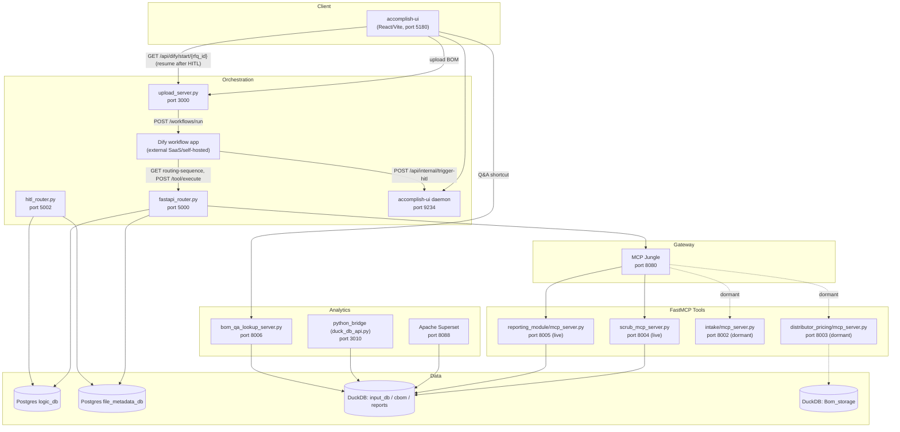
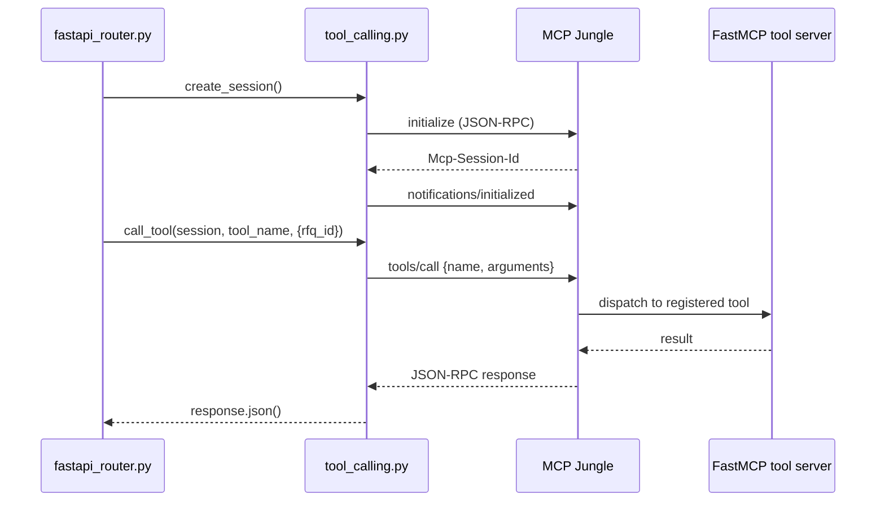

# Architecture Overview

## Table of Contents

- [What this platform is](#what-this-platform-is)
- [High-level component map](#high-level-component-map)
- [Request lifecycle](#request-lifecycle)
- [Workflow lifecycle](#workflow-lifecycle)
- [Routing lifecycle](#routing-lifecycle)
- [MCP lifecycle](#mcp-lifecycle)
- [Data flow](#data-flow)
- [Error handling](#error-handling)
- [Retry strategy](#retry-strategy)
- [Logging](#logging)
- [Monitoring](#monitoring)
- [Security](#security)
- [Authentication / Authorization](#authentication--authorization)
- [Deployment model](#deployment-model)
- [Scalability](#scalability)
- [Extensibility](#extensibility)
- [Related documents](#related-documents)

## What this platform is

A BOM/RFQ costing automation platform (the user's own umbrella name for the
whole assembly is "SRIM 3.2" — this string does not appear anywhere in the
platform's own source code; it's used here only as the project's name, not
as evidence of an internal version marker). It ingests a Bill of Materials
and related quote/costing documents for an RFQ, runs them through a
sequence of standardization → CBOM (Costed BOM) generation → enrichment →
human-reviewed final selection → report generation → Excel export, and
exposes the results through a web frontend and Apache Superset dashboards.

The orchestrator (an external Dify workflow — see
[DMR/dynamic-master-router.md](../DMR/dynamic-master-router.md)) contains no
project-specific business logic itself; it walks a list of tool names
fetched from Postgres and calls each one through a single gateway (MCP
Jungle). Each individual business capability (standardizing a BOM,
building a CBOM, generating a report) lives entirely inside its own
FastMCP tool.

## High-level component map

## Request lifecycle

1. A user uploads a BOM/QuoteWin/Costing Sheet via `accomplish-ui`.
2. `upload_server.py` persists the upload and calls `POST
   {DIFY_BASE_URL}/workflows/run` once with `{rfq_id}`.
3. Dify's workflow executes the full DMR loop (see
   [DMR/dynamic-master-router.md](../DMR/dynamic-master-router.md)) —
   fetch routing sequence, execute each remaining tool in order, stop early
   if a tool reports `hitl: 1`.
4. If halted for HITL, `hitl_router.py` exposes the conflict for human
   review (backed by `logic_db.final_selection_conflicts` — see
   [Backend/file-reference.md](../Backend/file-reference.md#hitl_routerpy)).
   Once resolved, the UI calls `GET /api/dify/start/{rfq_id}` to resume with
   a fresh Dify run.
5. On full completion, generated reports are available via
   `duck_db_api.py`'s export endpoints and/or Superset dashboards.

## Workflow lifecycle

A "workflow" here means one full pass of a `quote_routing_profiles` row.
See [DMR/dynamic-master-router.md](../DMR/dynamic-master-router.md) for the
complete node-by-node breakdown. In summary: fetch → truncate-by-skill-index
→ iterate-and-execute → (optionally halt-and-wait-for-human) → complete.

## Routing lifecycle

Routing is entirely data-driven from 2 Postgres tables
(`quote_routing_profiles`, `system_skills_registry`) and one runtime state
table (`rfq_process_tracking`) — see
[Database/logic-database.md](../Database/logic-database.md) for full
schema and real sample data. No workflow sequence is hardcoded in
application code (the one caveat: the *choice of which profile* to use is
currently a literal string inside the Dify graph itself, not read from
anywhere dynamic — see the DMR doc's note on this).

## MCP lifecycle

Full detail: [MCP/mcp-jungle.md](../MCP/mcp-jungle.md) and
[MCP/fastmcp-tools.md](../MCP/fastmcp-tools.md).

## Data flow

Two storage tiers, used for genuinely different purposes:
- **Postgres** (`logic_db`, `file_metadata_db`) — workflow config and
  per-RFQ pipeline progress. Small, relational, low-volume writes.
- **DuckDB** (`input_db.duckdb`, `cbom.duckdb`, `reports.duckdb`, plus the
  separate `Bom_storage.duckdb` used by `distributor_pricing`) — the actual
  BOM/CBOM/report data, analytical in nature, read by Superset directly and
  by `duck_db_api.py`/`bom_qa_lookup_server.py` for API access.

`input_db.duckdb` is always opened read-only by the reporting pipeline
(see [Reporting/reporting-module.md](../Reporting/reporting-module.md)) —
it's populated exclusively by `scrub_mcp_server.py`'s standardization
tools, never by the reporting side.

## Error handling

No single centralized error-handling layer exists across the whole
platform — each layer handles errors differently:
- The **Dify workflow** has exactly one deliberate error path (the HITL
  halt, which works by intentionally raising an exception — see
  [DMR/dynamic-master-router.md](../DMR/dynamic-master-router.md#failure-handling--hitl-halt)).
  A genuine tool failure (not a HITL signal) is not specially handled by
  any node in the graph.
- **`tool_calling.py`** only calls `raise_for_status()` on the initial
  handshake; `call_tool()`/`list_tools()` return raw JSON regardless of
  whether it represents a JSON-RPC-level error.
- Individual **FastMCP tools** and **Excel report builders** use targeted,
  documented patterns for their own failure modes (e.g. `reporting_module`'s
  blank-guard-before-compute convention for Excel formulas — see
  [Reporting/reporting-module.md](../Reporting/reporting-module.md)).

## Retry strategy

Only observed at the HTTP-node level inside the Dify workflow itself: the
routing-sequence lookup node has retries enabled (3 max, 100ms interval);
the `/tool/execute` node has retries explicitly **disabled** (a failed or
slow tool call is not automatically retried — likely deliberate, since
retrying a partially-completed side-effecting operation like a DB write
could double-apply it). No application-level retry/backoff logic was found
in `tool_calling.py`, `fastapi_router.py`, or the FastMCP tool servers
themselves.

## Logging

`manage_backend.py` writes each service's stdout/stderr to
`centum intake\service_logs\` (one log per service). `reporting_module` has
its own `logging_utils.py` and `LOGS_DIR` (see
[Reporting/reporting-module.md](../Reporting/reporting-module.md)). No
centralized/aggregated logging (e.g. a log shipper or structured-logging
standard applied uniformly) was found across all services — each is
independent.

## Monitoring

`manage_backend.py status`/`monitor` is the primary monitoring surface:
HTTP health-checks each of the 10 registered services plus 3 external
dependencies (Postgres, Ollama, MCP Jungle gateway), reporting HEALTHY/
UNHEALTHY per service. See
[Deployment/deployment.md](../Deployment/deployment.md) for the full
mechanism and service list.

## Security

No authentication/authorization layer was found on the internal HTTP APIs
(`fastapi_router.py`, `hitl_router.py`, `upload_server.py`,
`duck_db_api.py`, `bom_qa_lookup_server.py`) as currently implemented —
these appear to be trusted-network-only services (bound to
`127.0.0.1`/`192.168.1.27`, not exposed publicly). MCP Jungle's own
`create_session()` handshake requires a protocol-level session ID but no
credential/token was observed being sent. This should be treated as a real
gap to close before any of these services are exposed beyond a trusted
local network, not as an intentional design choice with a defined identity
model.

## Authentication / Authorization

See [Security](#security) above — no application-level auth was found in
this codebase for the backend services. `accomplish-ui` (a separate
product) has its own auth system (`loginWithPat`, `loginWithEmailPassword`,
`loginWithGoogle` in `src/client/lib/session.ts` — see
[Frontend/accomplish-ui.md](../Frontend/accomplish-ui.md)) but that governs
access to the *frontend/daemon*, not to the BOM/RFQ backend services
documented here.

## Deployment model

Single-machine, process-per-service, orchestrated by `manage_backend.py`
(no containers/orchestrator observed for the core backend as of this
writing). See [Deployment/deployment.md](../Deployment/deployment.md) for
the full current-state vs. target-state picture (the new `BuLLMQuote-SRIM`
repo's `docker-compose.yml`/`INSTALL.bat`/`LAUNCH-WEB.bat` are placeholders
anticipating a containerized future, not yet functional for the backend).

## Scalability

Not designed for horizontal scale as currently implemented: `rfq_id`-keyed
Postgres state plus local DuckDB files on one machine mean there's a single
point of both compute and storage. The `(rfq_id, version)` keying and the
resumable, stateless-per-step DMR design (see
[DMR/dynamic-master-router.md](../DMR/dynamic-master-router.md#state-management))
would support running multiple RFQs concurrently on the same machine
without interference, since state is fully externalized to Postgres/DuckDB
rather than held in any long-lived process memory — but true horizontal
scale (multiple machines) would need the DuckDB files replaced with a
shared/networked store, since DuckDB is an embedded, single-process-writer
database.

## Extensibility

The platform's core extensibility mechanism is exactly the one described
in [Architecture/design-principles.md](../Architecture/design-principles.md):
add a Postgres row, don't change code. See
[MCP/fastmcp-tools.md](../MCP/fastmcp-tools.md#registration-process) for
the concrete steps to add a new tool, and
[Database/logic-database.md](../Database/logic-database.md#extension-guide)
for adding a new skill or workflow profile.

## Related documents

- [Architecture/design-principles.md](../Architecture/design-principles.md)
- [DMR/dynamic-master-router.md](../DMR/dynamic-master-router.md)
- [MCP/mcp-jungle.md](../MCP/mcp-jungle.md), [MCP/fastmcp-tools.md](../MCP/fastmcp-tools.md)
- [Database/logic-database.md](../Database/logic-database.md)
- [Deployment/deployment.md](../Deployment/deployment.md)
- [CLAUDE_CONTEXT.md](../CLAUDE_CONTEXT.md)
