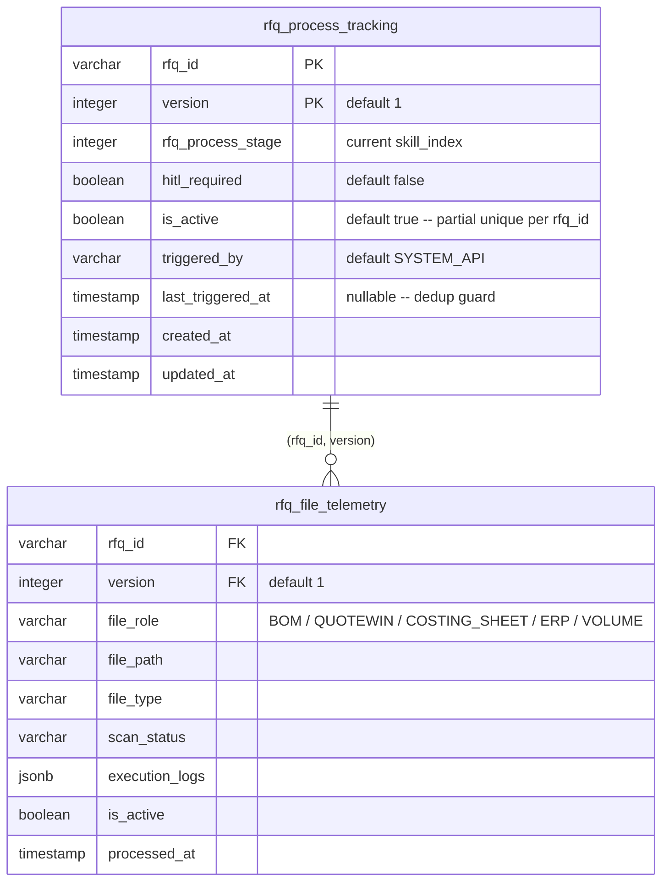
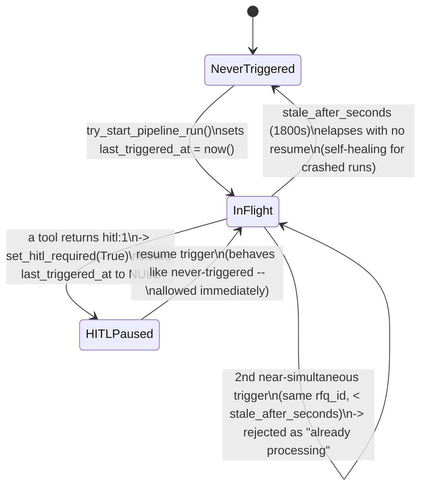

# `file_metadata_db` (PostgreSQL)

**Connection:** `FILE_METADATA_DB_URL` env var, required — `db.py` raises if unset (no fallback default; same prior-credential removal as `logic_db`).
**Accessed via:** `db.get_metadata_connection()` (a `@contextmanager` yielding a `psycopg2` connection).
**Holds:** per-RFQ **execution state** — where each RFQ's pipeline currently is, whether it's paused for a human, and which uploaded files belong to which version. This is the mutable counterpart to `logic_db`'s static configuration (see [logic-db.md](./logic-db.md)).

> Canonical maintained entry: [Database/logic-database.md](../Database/logic-database.md) (covers `rfq_process_tracking` with live sample data). This document adds `rfq_file_telemetry` and the `last_triggered_at` column, both confirmed directly from `db.py`/`upload_server.py`/`scrub_mcp_server.py` source but **not** re-verified via a fresh live `information_schema` introspection — flag for a follow-up pass per `CLAUDE.md`'s honesty requirement.

## Schema



`rfq_file_telemetry.(rfq_id, version)` has `ON DELETE CASCADE` back to `rfq_process_tracking(rfq_id, version)` — added by the same migration that introduced versioning (`ensure_version_schema()`, below).

## `rfq_process_tracking`

**Primary key:** `(rfq_id, version)`. **Indexes:** `idx_rfq_process_tracking_one_active` — a **partial unique index** `ON (rfq_id) WHERE is_active` enforcing "at most one active version per `rfq_id`" at the database level, not just in application code.

| Function | Op | Query shape |
|---|---|---|
| `get_active_version(rfq_id)` | Read | `SELECT version WHERE rfq_id=%s AND is_active` — raises if none |
| `get_current_skill_index(rfq_id)` | Read | `SELECT rfq_process_stage WHERE rfq_id=%s AND is_active` |
| `get_hitl_state(rfq_id)` | Read | `SELECT rfq_process_stage, hitl_required WHERE ... AND is_active` |
| `increment_skill_index(rfq_id)` | Write | `UPDATE ... SET rfq_process_stage = rfq_process_stage + 1 ... WHERE is_active RETURNING rfq_process_stage` |
| `advance_skill_index_to_at_least(rfq_id, min_index)` | Write | `UPDATE ... SET rfq_process_stage = GREATEST(rfq_process_stage, %s) ... WHERE is_active` — idempotent, never regresses |
| `set_skill_index(rfq_id, skill_index)` | Write | Direct `UPDATE ... SET rfq_process_stage = %s` |
| `set_hitl_required(rfq_id, value)` | Write | `UPDATE ... SET hitl_required=%s, last_triggered_at = CASE WHEN %s THEN NULL ELSE last_triggered_at END` |
| `try_start_pipeline_run(rfq_id, stale_after_seconds=1800)` | Read+Write | Advisory-lock-guarded check-then-set on `last_triggered_at` |

Every read/write filters `WHERE rfq_id = %s AND is_active` (never a bare `rfq_id` match) — critical once a second version can exist, since without the `is_active` filter an update would silently apply to **every** version's row at once.

### Why `advance_skill_index_to_at_least`, not a plain `+1`, for the HITL confirm

`resolve_final_selection` (see [reporting-mcp-server.md](./reporting-mcp-server.md)) **always** returns `hitl: 1`, even with zero conflicts — so it never self-advances `rfq_process_stage` past its own position. A naive `+1` from the human-approval confirm only reaches that same position again (Dify's own "is this RFQ still HITL-pending" check then reads that as "still not approved" and aborts every resume attempt). `advance_skill_index_to_at_least(rfq_id, min_index)` — called with `min_index` = that skill's index + 1 — moves the stage unambiguously past the gate in one call regardless of how many increments were "owed," and is safe to call more than once (e.g. a retried request) since it only ever moves forward.

### `last_triggered_at` — the concurrent-trigger dedup guard

Added by `ensure_processing_guard_schema()` (idempotent migration, same pattern as `ensure_version_schema()` below). Backs `try_start_pipeline_run()`: a **time-based heuristic**, not a hard lock released on completion — there is no "Dify workflow finished" signal that reaches this codebase, only per-step `/tool/execute` calls, so there's no clean event to release a real lock on.



`stale_after_seconds` defaults to 1800 (30 min) — comfortably longer than the realistic worst case (8 skills × up to 300s each) but not a guarantee; this deliberately favors self-healing (a crashed/abandoned run doesn't permanently block that RFQ) over perfect mutual exclusion. `pg_advisory_xact_lock(hashtext(rfq_id))` serializes the check-then-set so two requests racing on the same `rfq_id` can't both observe "not recently triggered."

**Why `set_hitl_required(True)` clears `last_triggered_at`:** without this, a real bug reproduces — the original trigger (e.g. a BOM upload) sets `last_triggered_at`, a human takes longer than a few seconds but well under 30 minutes to upload QuoteWin, and the resulting legitimate resume trigger gets wrongly rejected as "already processing" even though nothing has run since the pause began.

## `rfq_file_telemetry`

Tracks every uploaded file's role, path, and lifecycle per `(rfq_id, version)`.

| Caller | Op | Purpose |
|---|---|---|
| `upload_server.py` (`process_file_upload`) | Write | `UPDATE ... SET is_active=FALSE WHERE rfq_id=%s AND file_role=%s` (deactivate prior upload of the same role) then `INSERT INTO rfq_file_telemetry (rfq_id, version, file_role, file_path, file_type, scan_status, execution_logs, is_active) VALUES (..., TRUE)` |
| `upload_server.py` (`trigger_dify_workflow_internal`) | Write | `UPDATE ... SET execution_logs = execution_logs \|\| %s::jsonb WHERE rfq_id=%s AND file_role='BOM' AND is_active=TRUE` — appends telemetry without clobbering prior entries |
| `scrub_mcp_server.py` (`_fetch_file_path`) | Read | `SELECT file_path WHERE rfq_id=%s AND version=%s AND file_role=%s AND is_active=TRUE ORDER BY processed_at DESC LIMIT 1` |

`file_role` observed values: `BOM`, `QUOTEWIN`, `COSTING_SHEET`, `ERP`, and `VOLUME` (the last read only by the dormant `intake__import_bom` tool, not the live `Standard_BOM_Flow`).

The `is_active`/`ORDER BY processed_at DESC LIMIT 1` combination in the read path is itself a documented bug fix: earlier code had no such filter at all, and several real `rfq_id`s already had 2-3 duplicate `rfq_file_telemetry` rows, making file-path resolution silently non-deterministic (whichever row Postgres happened to return first).

## Versioning migration (`ensure_version_schema()`)

Idempotent, additive, self-verifying — matches `CLAUDE.md`'s stated coding standard for migrations. Called safely on every request (cheap `information_schema` check once already applied):

```sql
ALTER TABLE rfq_process_tracking ADD COLUMN version INTEGER NOT NULL DEFAULT 1;
ALTER TABLE rfq_process_tracking ADD COLUMN is_active BOOLEAN NOT NULL DEFAULT true;
ALTER TABLE rfq_file_telemetry DROP CONSTRAINT IF EXISTS rfq_file_telemetry_rfq_id_fkey;
ALTER TABLE rfq_process_tracking DROP CONSTRAINT rfq_process_tracking_pkey;
ALTER TABLE rfq_process_tracking ADD CONSTRAINT rfq_process_tracking_pkey PRIMARY KEY (rfq_id, version);
ALTER TABLE rfq_file_telemetry ADD COLUMN version INTEGER NOT NULL DEFAULT 1;
ALTER TABLE rfq_file_telemetry
    ADD CONSTRAINT rfq_file_telemetry_rfq_id_version_fkey
    FOREIGN KEY (rfq_id, version) REFERENCES rfq_process_tracking(rfq_id, version) ON DELETE CASCADE;
CREATE UNIQUE INDEX IF NOT EXISTS idx_rfq_process_tracking_one_active
    ON rfq_process_tracking (rfq_id) WHERE is_active;
CREATE INDEX IF NOT EXISTS idx_rfq_file_telemetry_rfq_version
    ON rfq_file_telemetry(rfq_id, version);
```

All pre-existing rows get `version=1, is_active=true` via the column defaults — safe against live data with no manual backfill (confirmed against a specific known state: 9 `rfq_process_tracking` rows / 20 `rfq_file_telemetry` rows at the time this migration was written).

### `db.versioned_key(rfq_id, version)` — the DuckDB-side isolation key

DuckDB tables (`scrub_bom_items`, `cbom`, etc.) have no `version` column at all, so version isolation there is simulated via a synthetic key: `version <= 1` maps to the **bare** `rfq_id` (unchanged, so every pre-versioning RFQ's existing DuckDB data stays reachable), and `version >= 2` maps to `f"{rfq_id}__v{version}"`. This same key also scopes `final_selection_conflicts`-adjacent DuckDB writes in `cbom.duckdb`.

## Known caveats / gaps

- `rfq_file_telemetry` is **not yet documented** in [Database/logic-database.md](../Database/logic-database.md) — same gap noted in [logic-db.md](./logic-db.md) for `final_selection_conflicts`; both should be folded into that canonical doc on its next update.
- `try_start_pipeline_run`'s guard is explicitly a time-based heuristic, not a hard lock — the module's own docstring calls this an "honest limitation," not a solved problem.
- Same hardcoded-plaintext-credential default as `logic_db`.

## Related documents

- [Database/logic-database.md](../Database/logic-database.md) — canonical schema doc.
- [logic-db.md](./logic-db.md) — the sibling database holding routing configuration and final-selection conflicts.
- [scrub-mcp-server.md](./scrub-mcp-server.md) — the primary reader of `rfq_file_telemetry`.
- [manage-backend.md](./manage-backend.md) — health-checks Postgres itself as an external dependency.
