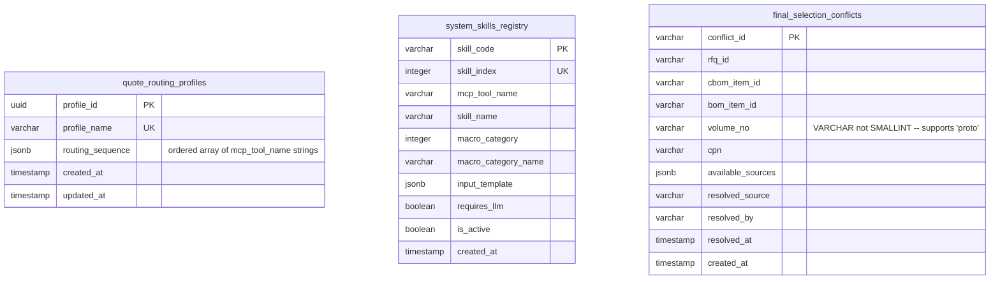
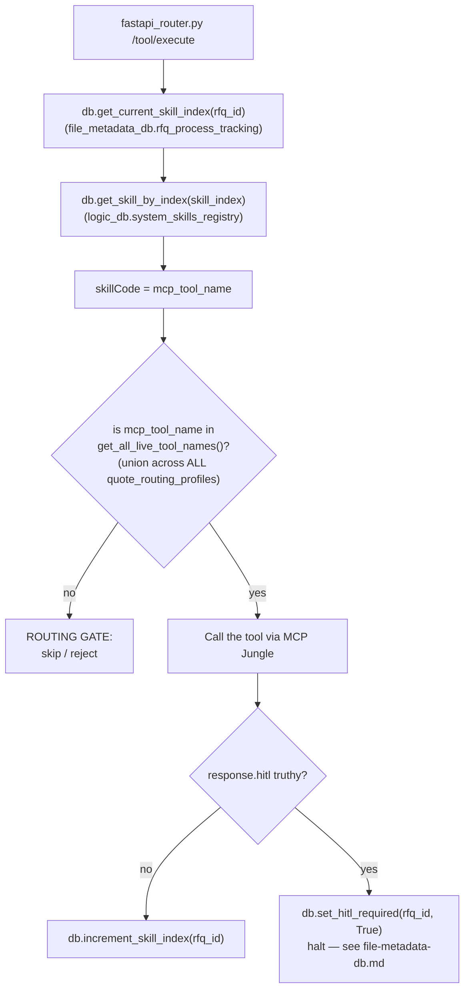

# `logic_db` (PostgreSQL)

**Connection:** `LOGIC_DB_URL` env var, required — `db.py` raises if unset (no fallback default; a prior hardcoded plaintext credential default was removed before this repo was pushed to GitHub).
**Accessed via:** `db.get_logic_connection()` (a `@contextmanager` yielding a `psycopg2` connection, closed on exit).
**Holds:** workflow/routing *configuration* — which tools run, in what order, and what each tool means — plus final-selection *human-review* state. Does not hold per-RFQ execution state; that's `file_metadata_db` (see [file-metadata-db.md](./file-metadata-db.md)).

> Canonical maintained entry: [Database/logic-database.md](../Database/logic-database.md) (includes real sample data from a live introspection). This document adds one table (`final_selection_conflicts`) that file does not yet cover, confirmed here directly from `reporting_module\final_selection.py`'s own `CREATE TABLE` DDL — not a live `information_schema` re-introspection, so treat row counts/sample data as unverified until that doc is refreshed.

## Schema



`quote_routing_profiles` and `system_skills_registry` are not foreign-keyed to each other — the link is logical: each string inside `routing_sequence` is expected to match some row's `mcp_tool_name` in `system_skills_registry`. `final_selection_conflicts.rfq_id` is likewise a logical (not FK-enforced) reference to `file_metadata_db.rfq_process_tracking.rfq_id`, since the two live in **separate Postgres databases** — cross-database foreign keys aren't possible in Postgres at all, which is itself a concrete illustration of `CLAUDE.md`'s open "multi-project isolation" gap discussion.

## `quote_routing_profiles`

Read by `db.get_routing_sequence(profile_name="Standard_BOM_Flow")` and `db.get_all_live_tool_names()` — both queried **fresh on every call, no caching**, so a routing-sequence edit in Postgres takes effect on the very next `/tool/execute` call.

```sql
SELECT routing_sequence FROM quote_routing_profiles WHERE profile_name = %s LIMIT 1;

SELECT DISTINCT tool FROM quote_routing_profiles,
    jsonb_array_elements_text(routing_sequence) AS tool;
```

`get_all_live_tool_names()` — the union across **every** profile, not one hardcoded name — backs `fastapi_router.py`'s "ROUTING GATE": a tool belonging to *any* live profile is treated as enabled. A single-profile check here previously meant every profile except whichever one was hardcoded had every one of its tools silently skipped.

No application code writes to this table — it's a pure configuration surface, edited directly in Postgres per `CLAUDE.md`'s "Configuration over Code" principle.

## `system_skills_registry`

Read by `db.get_skill_by_index(skill_index)` and `db.get_skill_by_code(mcp_tool_name)`, both returning the same normalized shape:

```python
{"skillIndex": ..., "skillCode": ..., "skillName": ..., "macroCategory": ..., "macroCategoryName": ...}
```

`db.advance_execution(rfq_id)` composes `increment_skill_index()` (writes to `file_metadata_db`) with `get_skill_by_index()` (reads from `logic_db`) — one logical "move to the next skill" operation spans both databases with no cross-database transaction, another concrete facet of the isolation gap.

Like `quote_routing_profiles`, this is a pure catalog/registry — no writes from application code.

## `final_selection_conflicts`

Written and read exclusively by `reporting_module\final_selection.py` and `hitl_router.py` — the storage for `resolve_final_selection`'s HITL gate (see [reporting-mcp-server.md](./reporting-mcp-server.md)).

```sql
CREATE TABLE IF NOT EXISTS final_selection_conflicts (
    conflict_id VARCHAR PRIMARY KEY,
    rfq_id VARCHAR NOT NULL,
    cbom_item_id VARCHAR NOT NULL,
    bom_item_id VARCHAR,
    volume_no VARCHAR,
    cpn VARCHAR,
    available_sources JSONB,
    resolved_source VARCHAR,
    resolved_by VARCHAR,
    resolved_at TIMESTAMP,
    created_at TIMESTAMP DEFAULT now()
);
CREATE INDEX IF NOT EXISTS idx_final_selection_conflicts_rfq
    ON final_selection_conflicts(rfq_id, resolved_source);
```

Created/migrated idempotently by `final_selection.ensure_conflicts_table(pg_conn)` on every call (cheap `information_schema` check once already migrated) — the same idiom `db.py`'s `ensure_version_schema()`/`ensure_processing_guard_schema()` use on the `file_metadata_db` side (see [file-metadata-db.md](./file-metadata-db.md)). Includes an in-place column-type upgrade (`volume_no` SMALLINT → VARCHAR) to support a `"proto"` volume literal alongside numbered volumes, applied only if the old type is still detected.

**Why Postgres, not DuckDB**, per the module's own docstring: this is workflow/human-review state (who's reviewing what, what's been decided) needing real concurrent-writer support and transactional guarantees for multiple reviewers — not analytical CBOM data. `cbom.duckdb` remains the system of record for CBOM *values*; it only receives a write once a conflict is actually resolved (`apply_resolved_conflict`), never the in-progress review state itself.

**Re-run behavior:** `resolve_final_selection` is idempotent — each run first `DELETE`s this `rfq_id`'s **unresolved** (`resolved_source IS NULL`) conflicts before inserting the current set, so a re-run never discards an already-completed human review, but does refresh which rows are still pending.

## How routing resolves to an executing tool



## Known caveats / gaps

- `final_selection_conflicts` is **not yet documented** in [Database/logic-database.md](../Database/logic-database.md) — this file fills that gap; the canonical doc should be updated to include it the next time it's touched, per `CLAUDE.md`'s maintenance policy.
- No multi-project isolation: one shared Postgres credential, one `logic_db`, today — see [Database/logic-database.md#logic-database-isolation](../Database/logic-database.md#logic-database-isolation) for the prescriptive fix.
- `LOGIC_DB_URL`'s hardcoded default embeds a plaintext password — real, unremediated, and platform-wide (also appears in `FILE_METADATA_DB_URL`'s default).

## Related documents

- [Database/logic-database.md](../Database/logic-database.md) — canonical schema doc with live sample data for `quote_routing_profiles`/`system_skills_registry`/`rfq_process_tracking`.
- [file-metadata-db.md](./file-metadata-db.md) — the sibling database holding per-RFQ execution state.
- [reporting-mcp-server.md](./reporting-mcp-server.md) — the tool (`resolve_final_selection`) that populates `final_selection_conflicts`.
- [DMR/dynamic-master-router.md](../DMR/dynamic-master-router.md) — how the Dify workflow consumes `routing_sequence`.
