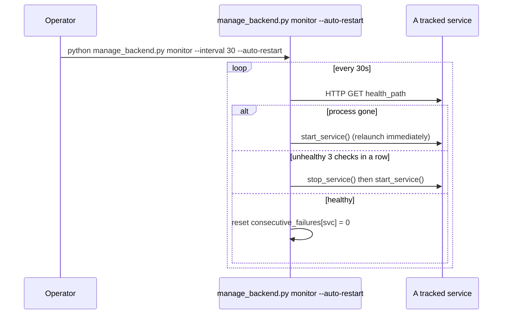

# `manage_backend.py`

**File path:** `C:\Users\ADMIN\Documents\SRIM\Tools\I n D\centum intake\manage_backend.py`
**Purpose:** The single script anyone runs to bring the entire backend up and know, at any moment, whether it's actually healthy — "not just 'the process exists,' but 'the port answers.'" (its own module docstring). Starts, stops, health-checks, and continuously monitors every backend service the platform needs, plus 3 external dependencies it does not itself start.

> Canonical maintained entries: [Backend/overview.md](../Backend/overview.md) (service map, startup process) and [Deployment/deployment.md](../Deployment/deployment.md) (orchestration mechanics, multi-user topology).

## Architecture

```mermaid
flowchart TB
    CLI["manage_backend.py\nstart / stop / restart / status / monitor"] --> State[(".backend_services_state.json"\n"PID, started_at, log_file, port per service")]

    CLI --> S1["upload_server.py :3000"]
    CLI --> S2["fastapi_router.py :5000"]
    CLI --> S3["hitl_router.py :5002"]
    CLI --> S4["scrub_mcp_server.py :8004"]
    CLI --> S5["reporting_module/mcp_server.py :8005"]
    CLI --> S6["bom_qa_lookup_server.py :8006"]
    CLI --> S7["duck_db_api.py :3010\n(python_bridge)"]
    CLI --> S8["vite.CMD :5180\n(web_frontend, accomplish-ui)"]
    CLI --> S9["superset.exe run :8088"]
    CLI --> S10["node dist/index.js :9234\n(daemon, pnpm pre-build)"]

    CLI -.->|"health-checked,\nnot started"| E1["postgres :5432\n(logic_db / file_metadata_db)"]
    CLI -.-> E2["ollama :11434"]
    CLI -.-> E3["mcp_jungle_gateway :8080"]
```



## Responsibilities

- Define the authoritative `SERVICES` list (10 entries) — confirmed by grepping every top-level `.py` file for `uvicorn.run()`/`mcp.run()` calls, not guessed from memory.
- Start each service not already running, waiting up to 30s per service for its declared health check to pass.
- Stop every tracked service (and its child process tree) cleanly, falling back to `kill()` after an 8s grace period.
- Report one-shot health/process status (`status`, exit code 0/1) or continuously monitor with an optional `--auto-restart`.
- Health-check 3 **external** dependencies (Postgres, Ollama, MCP Jungle) it does not itself manage, since a service process being "up" can still mean every real request fails if one of these is down.
- Persist PIDs/log paths/start times to `.backend_services_state.json` so `status`/`stop`/`monitor` work correctly even invoked from a separate process than whichever `start` call launched things.

## Public interface — CLI commands

| Command | Behavior |
|---|---|
| `start` | Starts every service in `SERVICES` not already running (skips if a tracked PID is alive; warns and refuses to double-start if the port is already bound by something untracked). |
| `stop` | Stops every tracked service — terminates child processes first, then the parent, `kill()`s anything still alive after an 8s wait. |
| `restart` | `stop` then `start` (1s pause between). |
| `status` | One-shot report; process exits `0` if every service + external dependency is healthy, else `1`. |
| `monitor [--interval SECONDS] [--auto-restart]` | Loops `print_status()` every `interval` seconds (default 30). With `--auto-restart`: immediately relaunches a service whose **process** is gone, or stops+restarts one that's been unhealthy (process alive, health check failing) for 3 consecutive checks. |

## Service inventory (`SERVICES`, 10 entries)

| Service | Port | Health check | Launch mechanism |
|---|---|---|---|
| `upload_server` | 3000 | `GET /docs` → 2xx | `python upload_server.py` |
| `fastapi_router` | 5000 | `GET /docs` → 2xx | `python fastapi_router.py` |
| `hitl_router` | 5002 | `GET /docs` → 2xx | `python hitl_router.py` |
| `scrub_mcp_server` | 8004 | `GET /` → any HTTP response | `python scrub_mcp_server.py` |
| `reporting_mcp_server` | 8005 | `GET /` → any HTTP response | `python reporting_module/mcp_server.py` (cwd = `reporting_module/`) |
| `bom_qa_lookup_server` | 8006 | `GET /` → 2xx | `python bom_qa_lookup_server.py` — plain read-only JSON lookup, not an MCP server |
| `python_bridge` (`duck_db_api.py`) | 3010 | `GET /docs` → 2xx | `python duck_db_api.py` — wraps `reporting_module`'s own DB functions for the frontend |
| `web_frontend` | 5180 | `GET /` → 2xx | `vite.CMD` invoked directly (not via `pnpm dev`, which orphans the tracked PID on Windows) |
| `superset` | 8088 | `GET /health` → 2xx | `C:\Superset\venv\Scripts\superset.exe run -h 0.0.0.0 -p 8088 --with-threads --reload --debugger`, with `SUPERSET_CONFIG_PATH` set explicitly (cwd-based config discovery was observed to silently fall back to an insecure default `SECRET_KEY` after a reboot) |
| `daemon` | 9234 | `GET /health` → 2xx | `pnpm run build` (synchronous pre-build) then `node dist/index.js`, with `ACCOMPLISH_DAEMON_DEV=1` / `ACCOMPLISH_APP_PATH` env overrides |

`health_kind` is either `http_2xx` (must return 200–299) or `http_any` (FastMCP's streamable-HTTP transport serves no root route, so any HTTP response at all — even 404 — proves the port is bound and the process is genuinely serving, as opposed to "connection refused").

## External dependencies (health-checked only)

| Name | Check |
|---|---|
| `postgres (logic_db/file_metadata_db)` | TCP connect to `localhost:5432` |
| `ollama` | `GET http://localhost:11434/api/tags` → 2xx |
| `mcp_jungle_gateway` | `GET http://localhost:8080/` → any response |

## Hardcoded absolute paths

| Constant | Value |
|---|---|
| `PROJECT_ROOT` | `dirname(__file__)` (i.e. `centum intake\`) |
| `REPORTING_DIR` | `{PROJECT_ROOT}\reporting_module` |
| `ACCOMPLISH_UI_ROOT` | `C:\Users\ADMIN\Downloads\accomplish-ui\accomplish-ui` (a separate checkout entirely) |
| `FRONTEND_DIR` / `FRONTEND_VITE_BIN` | `{ACCOMPLISH_UI_ROOT}\apps\web`, `...\node_modules\.bin\vite.CMD` |
| `DAEMON_DIR` / `DESKTOP_DIR` | `{ACCOMPLISH_UI_ROOT}\apps\daemon`, `...\apps\desktop` |
| `STATE_FILE` | `{PROJECT_ROOT}\.backend_services_state.json` |
| `LOG_DIR` | `{PROJECT_ROOT}\service_logs` |
| Superset `cmd`/`cwd`/`env` | `C:\Superset\venv\Scripts\superset.exe`, `C:\Superset`, `C:\Superset\superset_config.py` |

**Relocating any service breaks its manageability until every one of these paths is updated** — this is the concrete mechanism behind `CLAUDE.md`'s "hardcodes absolute filesystem paths for every service" constraint.

## Execution flow — subprocess mechanics

- `subprocess.Popen(argv, cwd=svc["cwd"], stdout=log_file, stderr=subprocess.STDOUT, creationflags=CREATE_NEW_PROCESS_GROUP, env=env)` — `CREATE_NEW_PROCESS_GROUP` (Windows-only) isolates each service into its own process tree for clean termination.
- A service can override the default `[PYTHON, svc["script"]]` invocation with an explicit `cmd` argv list (e.g. `web_frontend`'s `vite.CMD`, `daemon`'s `node dist/index.js`) — needed because `.cmd`-shim tools (`pnpm`, `vite` via `pnpm dev`) exit once they hand off to the real process on Windows, silently orphaning the tracked PID; invoking the real executable directly keeps one stable, `terminate()`-able PID.
- `pre_build_cmd` (daemon only) runs synchronously, with `shell=True`, **before** the tracked long-lived process starts, and is not itself tracked in `state` — it's expected to exit on its own.
- `stop_service()` walks `psutil.Process(pid).children(recursive=True)`, terminates children first, then the parent, waits up to 8s (`psutil.wait_procs`), then force-`kill()`s anything still alive.
- Every service's stdout/stderr is redirected to `service_logs/<name>.log`, with a `===== started <timestamp> =====` marker line on each start.
- `sys.stdout.reconfigure(line_buffering=True)` at import time — without it, `monitor`'s output would be delayed by Python's default full block-buffering whenever this script's own output is piped/redirected.

## Known caveats / gaps

- No authentication/authorization on any managed HTTP service — matches the platform-wide "no auth layer observed" limitation in `CLAUDE.md`.
- `try_start_pipeline_run`'s dedup guard (see [file-metadata-db.md](./file-metadata-db.md)) and this script's own port-conflict check (`_tcp_open` before `start_service`) are different mechanisms for different problems — this script prevents double-launching a *process*; the DB-side guard prevents a *pipeline run* from being triggered twice concurrently.

## Related documents

- [Backend/overview.md](../Backend/overview.md) — service map + startup process (canonical).
- [Deployment/deployment.md](../Deployment/deployment.md) — orchestration mechanics, multi-user production topology, known concurrency fixes.
- [Frontend/accomplish-ui.md](../Frontend/accomplish-ui.md) — the `web_frontend`/`daemon` services this script also manages.
