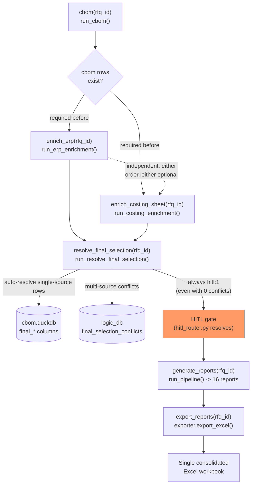

# `reporting_module\mcp_server.py`

**File path:** `C:\Users\ADMIN\Documents\SRIM\Tools\I n D\centum intake\reporting_module\mcp_server.py`
**Status:** Live — port 8005, registered with MCP Jungle as `centum_reporting`.
**Purpose:** The FastMCP tool server (`FastMCP("cbom-reporting")`) that runs the back half of the pipeline — CBOM generation, enrichment, the final-selection HITL gate, report generation, and Excel export. Exposes exactly 6 tools, each taking only `rfq_id`; no database paths, filenames, SQL, or Excel internals are ever exposed to a caller.

> Distinct from [scrub-mcp-server.md](./scrub-mcp-server.md) (`scrub_mcp_server.py`, port 8004) — same `mcp_server.py` basename, different file, different port, different tool set. The canonical maintained entry is [Reporting/reporting-module.md](../Reporting/reporting-module.md#mcp_serverpy); tool signatures are also indexed in [MCP/fastmcp-tools.md](../MCP/fastmcp-tools.md#reporting_mcp_server-live-port-8005).

## Architecture



Every tool body is wrapped in `with db.duckdb_file_lock():` — the same cross-process lock `scrub_mcp_server.py` uses, since `python_bridge` (`duck_db_api.py`) and `hitl_router.py` also open `input_db.duckdb`/`cbom.duckdb`/`reports.duckdb`.

## Responsibilities

Per the module's own docstring, the six tools are **independent stages, called in order**:

1. **`cbom`** — regenerate the CBOM table + `_qw` columns from `quote_win`, from the existing read-only input tables. Does not touch the 16 downstream reports.
2. **`enrich_erp`** — fill `_erp` columns on existing CBOM rows from ERP master data. Requires `cbom` to have already run. *Currently unused in the active routing sequence* (kept for future use — ERP intake is dormant).
3. **`enrich_costing_sheet`** — fill `_costing` columns from `costing_sheet` data. Requires `cbom` first. Independent of `enrich_erp` — either order, either or both skippable.
4. **`resolve_final_selection`** — the HITL gate: auto-resolves rows where exactly one source (`_costing`/`_erp`/`_qw`) has data directly into `cbom.duckdb`'s `final_*` columns, and persists genuine multi-source conflicts to Postgres `logic_db.final_selection_conflicts` for human review (see [final_selection.py logic](#related-documents)). **Always** returns `"hitl": 1`, even with zero pending conflicts — this is the platform's only gate before Finalize Price / CBOM preview, so it must never be silently skipped.
5. **`generate_reports`** — regenerate all 16 reports from whatever CBOM data currently exists (does not regenerate CBOM itself).
6. **`export_reports`** — export the already-generated CBOM + 16 reports into one consolidated Excel workbook. Read-only; does not regenerate any data.

## Public interface

| Tool | Param | Returns | Delegates to |
|---|---|---|---|
| `cbom` | `rfq_id: str` | `dict` — row counts, execution time, warnings | `reporting_pipeline.run_cbom(rfq_id)` |
| `enrich_erp` | `rfq_id: str` | `dict` | `reporting_pipeline.run_erp_enrichment(rfq_id)` |
| `enrich_costing_sheet` | `rfq_id: str` | `dict` | `reporting_pipeline.run_costing_enrichment(rfq_id)` |
| `resolve_final_selection` | `rfq_id: str` | `dict` — `hitl`, `pending_conflicts`, `review_required` (never the conflict rows themselves — an RFQ can have thousands) | `reporting_pipeline.run_resolve_final_selection(rfq_id)` |
| `generate_reports` | `rfq_id: str` | `dict` — `status`, `report_row_counts`, `error` | `reporting_pipeline.run_pipeline(rfq_id)` |
| `export_reports` | `rfq_id: str` | `dict` — `status`, `worksheet_count`, `error` | `exporter.export_excel(rfq_id)` |

All 6 return a native `dict` (unlike `scrub_mcp_server.py`'s tools, which return JSON-encoded strings) — serialization to the MCP wire format is left to the FastMCP framework.

## Dependencies

- **Third-party:** `fastmcp` (`FastMCP`).
- **Local (this folder):** `exporter`, `reporting_pipeline`, `logging_utils.logger` (see [logging-utils.md](./logging-utils.md)), `analytics_events`, `analytics_posthog_client`.
- **Local (parent `centum intake` root, explicitly path-appended):** `db` — imported here specifically (not in `database.py`/`reporting_pipeline.py`/`exporter.py`, which stay import-clean of anything outside `reporting_module/` so the module can be ported to a different project by touching only `config.py`) purely to reach `db.duckdb_file_lock()`.
- **Stdlib:** `os`, `sys`, `time`.

`sys.path` handling: this file's own directory is inserted at index 0 (so `reporting_module`'s own same-named modules always win); `centum intake`'s root is **appended**, not inserted at 0, specifically so its `db.py` import resolves without shadowing anything inside `reporting_module`.

## Execution flow

Each tool follows the same shape:

```python
@mcp.tool
def <name>(rfq_id: str) -> dict:
    try:
        with db.duckdb_file_lock():
            return <reporting_pipeline function>(rfq_id)
    except Exception as e:
        logger.exception(f"<name> tool failed for rfq_id={rfq_id!r}")
        return {"status": "failed", "rfq_id": rfq_id, "error": str(e)}
```

`generate_reports` and `export_reports` additionally wrap this in a `time.monotonic()` timer and fire PostHog analytics (`report_generated`/`report_generation_failed`, `report_export_generated`/`report_export_failed`) bucketed by duration and report/worksheet count.

Run directly (`python mcp_server.py`) it binds `0.0.0.0:8005` (not one fixed LAN IP — binding a single interface address would refuse connections on every other interface, e.g. a VPN virtual adapter, regardless of firewall rules). `mcp` can also be imported directly for in-process testing via `fastmcp.Client(mcp)`.

## Known caveats / gaps

- `resolve_final_selection` **always** sets `hitl: 1`, which means `advance_skill_index_to_at_least()` (not a plain `+1`) is required to move `rfq_process_stage` past it once a human confirms — see [logic-db.md](./logic-db.md) and [file-metadata-db.md](./file-metadata-db.md) for why a naive increment gets stuck exactly at this gate.
- `enrich_erp` is fully wired but not part of the live `Standard_BOM_Flow` routing sequence today (ERP intake is dormant) — don't assume it runs in production.

## Related documents

- [Reporting/reporting-module.md](../Reporting/reporting-module.md) — the full reporting pipeline (`reporting_pipeline.py`, `cbom_generator.py`, `enrichment.py`, all 16 `reports/*.py` builders).
- [MCP/fastmcp-tools.md](../MCP/fastmcp-tools.md) — cross-server tool inventory.
- [logic-db.md](./logic-db.md) — `final_selection_conflicts` schema (in `logic_db`), written by `final_selection.py`, read/resolved via `hitl_router.py`.
- [logging-utils.md](./logging-utils.md) — the `logger` this file imports.
