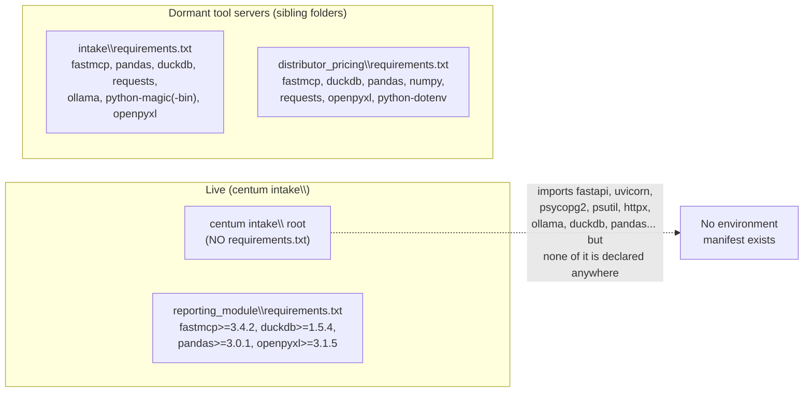

# `requirements.txt`

**Verified directly against the filesystem for this document** (a prior research pass had conflated the *dormant* `intake\requirements.txt` with the live `centum intake\` root — corrected below). Three real files exist across the platform's Python code; the live `centum intake` root itself has **no `requirements.txt` of its own**, which is a real, worth-flagging gap, not an omission in this doc.

## Inventory

| Location | Status | Dependency count | Versions pinned? |
|---|---|---|---|
| `centum intake\` (root) | **Does not exist** | n/a | n/a |
| `centum intake\reporting_module\requirements.txt` | **Live** | 4 | Yes (`>=`) |
| `intake\requirements.txt` (dormant tool server, sibling of `centum intake`, not inside it) | Dormant | 8 | No |
| `distributor_pricing\requirements.txt` (dormant tool server) | Dormant | 7 | No |



## `centum intake\reporting_module\requirements.txt` (the only live one)

```
fastmcp>=3.4.2
duckdb>=1.5.4
pandas>=3.0.1
openpyxl>=3.1.5
```

| Package | Category | Used for |
|---|---|---|
| `fastmcp` | MCP server framework | `mcp_server.py`'s `FastMCP("cbom-reporting")` — see [reporting-mcp-server.md](./reporting-mcp-server.md) |
| `duckdb` | Embedded analytical DB driver | `database.py`'s `connect()`, all of `cbom_generator.py`/`enrichment.py`/`report_generator.py` |
| `pandas` | Dataframe processing | `helpers.py` and report builders |
| `openpyxl` | Excel read/write | `exporter.py`, `excel_formatter.py`, `excel_formulas.py` — the final workbook export |

This is the only `requirements.txt` inside the live, currently-deployed part of the platform.

## The `centum intake\` root has no `requirements.txt`

Confirmed by direct filesystem check (`glob "**/requirements*.txt"` under `centum intake\`) — only the `reporting_module\` subfolder has one. Yet the root's own files import third-party packages freely, none of which are declared in any manifest:

| Package | Imported by (examples) |
|---|---|
| `fastmcp` | `scrub_mcp_server.py` |
| `fastapi`, `uvicorn`, `pydantic` | `fastapi_router.py`, `hitl_router.py`, `duck_db_api.py`, `upload_server.py` |
| `httpx` | `fastapi_router.py` (calls out to Dify) |
| `psycopg2` | `db.py` (all Postgres access) |
| `psutil` | `manage_backend.py` (process tracking) |
| `duckdb` | `scrub_bom_to_database.py`, `bom_qa_lookup_server.py`, `duck_db_api.py`, `hitl_router.py` |
| `pandas` | `hitl_router.py`, `scrub_bom_processing.py`, `quote_win_processing.py`, `erp_processing.py` |
| `openpyxl` | `duck_db_api.py` |
| `ollama` | `scrub_bom_processing.py`, `quote_win_processing.py`, `erp_processing.py`, `costing_sheet_processing.py` (LLM-assisted schema mapping) |

This list was built by grepping every `.py` file directly under `centum intake\` for top-level `import`/`from` statements — it is a real, current inventory, not a guess, but it is **not** a substitute for an actual manifest: there is currently no single file a new environment setup can run `pip install -r` against to reproduce the root's dependencies. This should be flagged as a concrete follow-up (generate a root `requirements.txt`, e.g. via `pip freeze` against the known-working environment) alongside the other items in `CLAUDE.md`'s "Future improvements" list.

## Dormant tool servers, for comparison

Both dormant tool servers (`intake\`, `distributor_pricing\` — see [MCP/intake-tool-reference.md](../MCP/intake-tool-reference.md) and [MCP/distributor-pricing-tool-reference.md](../MCP/distributor-pricing-tool-reference.md)) **do** each ship their own `requirements.txt`, unpinned:

```
# intake\requirements.txt
fastmcp
pandas
duckdb
requests
ollama
python-magic-bin; platform_system == "Windows"
python-magic; platform_system != "Windows"
openpyxl
```

```
# distributor_pricing\requirements.txt
fastmcp
duckdb
pandas
numpy
requests
openpyxl
python-dotenv
```

This is exactly the "own `requirements.txt`" independence [MCP/fastmcp-tools.md](../MCP/fastmcp-tools.md) cites as proof each tool server is independently deployable — but note it's a pattern the *dormant* servers and `reporting_module` follow, not one the live `centum intake` root itself follows.

## Related documents

- [Reporting/reporting-module.md](../Reporting/reporting-module.md#requirementstxt) — canonical entry for `reporting_module\requirements.txt`.
- [MCP/intake-tool-reference.md](../MCP/intake-tool-reference.md#requirementstxt) / [MCP/distributor-pricing-tool-reference.md](../MCP/distributor-pricing-tool-reference.md#requirementstxt) — the two dormant servers' own manifests.
- [Architecture/design-principles.md](../Architecture/design-principles.md) — "Modular Architecture" claim this file's per-server independence supports.
