# `scrub_mcp_server.py`

**File path:** `C:\Users\ADMIN\Documents\SRIM\Tools\I n D\centum intake\scrub_mcp_server.py`
**Status:** Live — port 8004, registered with MCP Jungle as part of the `centum_intake` server group.
**Purpose:** The FastMCP tool server (`FastMCP("ScrubIntake")`) that performs the first stage of every RFQ pipeline run — schema-mapping and standardizing the raw uploaded workbooks (SCRUB BOM, QuoteWin, Costing Sheet, ERP) into DuckDB, with no volume expansion, consolidation, or duplicate-CPN detection (those are explicitly out of scope for this server).

> This is a standalone deep-dive. The canonical, continuously-maintained entry for this file also lives in [Backend/file-reference.md](../Backend/file-reference.md#scrub_mcp_serverpy) and its tool signatures are indexed in [MCP/fastmcp-tools.md](../MCP/fastmcp-tools.md#scrub_mcp_server-live-port-8004) — check those first if this file feels stale.

## Architecture

```mermaid
flowchart TD
    Jungle["MCP Jungle\n(gateway)"] -->|"/tool/execute per skill"| Tool{"Which tool?"}

    Tool -->|standardize_scrub_bom| A1["_fetch_file_path\n(file_role='BOM')"]
    Tool -->|standardize_quote_win| A2["_fetch_file_path\n(file_role='QUOTEWIN')"]
    Tool -->|standardize_costing_sheet| A3["_fetch_file_path\n(file_role='COSTING_SHEET')"]
    Tool -->|standardize_erp| A4["_fetch_file_path\n(file_role='ERP')"]

    A1 -->|SQL via postgres_metadata\ntool over MCP| PG[("rfq_file_telemetry\n(file_metadata_db)")]
    A2 --> PG
    A3 --> PG
    A4 --> PG

    A1 -->|file found| P1["process_scrub_bom_workbook()"]
    A2 -->|file found| P2["process_quote_win()"]
    A3 -->|file found, else 'skipped'| P3["process_costing_sheet()"]
    A4 -->|file found, else 'skipped'| P4["process_erp()"]

    P1 --> L["duckdb_file_lock()\n(cross-process serialization)"]
    P2 --> L
    P3 --> L
    P4 --> L

    L --> D1[("scrub_bom_items\nvolume\nbatch")]
    L --> D2[("quote_win")]
    L --> D3[("costing_sheet")]
    L --> D4[("erp\n(standing, not RFQ-scoped)")]

    P1 -.->|"fresh success only"| HITL["response.hitl = 1\n(pauses pipeline for\nQuoteWin/Costing upload)"]

    style HITL fill:#f96,stroke:#333
```

All 4 tools guard their `rfq_id` through `_validate_id()` — a regex check (`^[A-Za-z0-9_\-]+$`) run **before** the value is ever interpolated into a SQL string, since `_fetch_file_path()` builds its `SELECT` via f-string, not a parameterized query.

## Responsibilities

- Standardize a **SCRUB BOM** workbook (`standardize_scrub_bom`): maps 3 sheets (`SCRUB BOM` → `scrub_bom_items`, `Settings` → `volume`, `Batch` → `batch`) and writes all three to DuckDB atomically under one `duckdb_file_lock()`.
- Standardize a **QuoteWin** (Awards Part Number Listing) report (`standardize_quote_win`) into the `quote_win` table.
- Standardize a **Costing Sheet** report (`standardize_costing_sheet`) into `costing_sheet` — optional upload, returns `"status": "skipped"` (not a failure) if none exists for the RFQ.
- Standardize an **ERP** purchase-history export (`standardize_erp`) into a standing (non-RFQ-scoped) `erp` reference table — currently always returns `"skipped"` since ERP has no live upload path (`upload_server.py`'s endpoint was repurposed for Costing Sheet); kept fully working for when ERP uploads are reintroduced.
- Resolve each tool's input file path by querying `rfq_file_telemetry` (in `file_metadata_db`) through the `postgres_metadata__execute_sql` MCP tool, rather than accepting a file path directly from the caller.
- Fire PostHog analytics events (`upload_processing_started/completed/failed`) around the BOM/QuoteWin/Costing Sheet paths.
- Raise the pipeline's first HITL checkpoint: on a **fresh** successful `standardize_scrub_bom` run, set `"hitl": 1` in the response so `fastapi_router.py` halts `rfq_process_stage` advancement until the user has uploaded QuoteWin/Costing Sheet.

## Public interface

| Tool | Params | Returns | Notes |
|---|---|---|---|
| `standardize_scrub_bom` | `rfq_id`, `version=1` | JSON string: `status`, per-table results (`scrub_bom_items`/`volume`/`batch`), `hitl` (conditional) | Hard-fails if no BOM file is registered for the RFQ. |
| `standardize_quote_win` | `rfq_id`, `version=1` | JSON string: `status`, `rows_standardized` | Hard-fails if no QuoteWin file exists. |
| `standardize_costing_sheet` | `rfq_id`, `version=1` | JSON string: `status` (`success`/`skipped`/`failed`), `rows_standardized` | Gracefully skips if no file was uploaded. |
| `standardize_erp` | `rfq_id`, `version=1` | JSON string: `status` (`skipped`/`failed`/success) | Always `"skipped"` in the current product; `version` accepted only for signature symmetry, unused. |

Internal (non-tool) helpers:

| Function | Purpose |
|---|---|
| `_validate_id(value) -> str` | Rejects any `rfq_id` not matching `[A-Za-z0-9_\-]+` before it's used in SQL string interpolation. |
| `_fetch_file_path(session, rfq_id_str, version, file_role) -> str \| None` | `SELECT file_path FROM rfq_file_telemetry WHERE rfq_id=... AND version=... AND file_role=... AND is_active=TRUE ORDER BY processed_at DESC LIMIT 1`, via `call_tool()` against `postgres_metadata__execute_sql`. Returns `None` if no row exists — callers decide whether that's fatal (BOM/QuoteWin) or skippable (Costing Sheet/ERP). |

## Dependencies

- **Third-party:** `fastmcp` (`FastMCP` server framework).
- **Local — processing:** `scrub_bom_processing.process_scrub_bom_workbook`, `quote_win_processing.process_quote_win`, `erp_processing.process_erp`, `costing_sheet_processing.process_costing_sheet`.
- **Local — persistence:** `scrub_bom_to_database.{process_scrub_bom_to_database, process_volume_to_database, process_batch_to_database}`, `quote_win_to_database.process_quote_win_to_database`, `erp_to_database.process_erp_to_database`, `costing_sheet_to_database.process_costing_sheet_to_database`.
- **Local — infra:** `tool_calling.{create_session, call_tool}` (MCP Jungle client used to reach the Postgres-metadata tool), `db.{versioned_key, duckdb_file_lock}`.
- **Local — analytics:** `analytics_events`, `analytics_posthog_client`.
- **Stdlib:** `ast` (parses the metadata tool's stringified result rows), `json`, `re`, `time`, `traceback`.

## Execution flow (worked example: `standardize_scrub_bom`)

1. `_validate_id(str(rfq_id).strip())` — reject on any SQL-unsafe character.
2. `key = versioned_key(rfq_id_str, version_int)` — resolves to the bare `rfq_id` for `version=1`, or `"{rfq_id}__v{version}"` for version ≥ 2, so DuckDB rows for different re-upload versions never collide (DuckDB tables have no `version` column of their own).
3. `create_session()` opens an MCP Jungle session; `_fetch_file_path(..., "BOM")` resolves the registered file path from `rfq_file_telemetry`, filtered to the active row for `(rfq_id, version, file_role)` — this filter is itself a bug fix: without `is_active`/`ORDER BY processed_at DESC`, duplicate telemetry rows made file-path resolution silently non-deterministic.
4. If no BOM file is registered: fire an `upload_processing_failed` analytics event and return `{"status": "failed", "error": "No BOM file uploaded..."}`.
5. Otherwise fire `upload_processing_started`, then run `process_scrub_bom_workbook(bom_file)`.
6. Inside `with duckdb_file_lock():` write all 3 resulting tables (`scrub_bom_items`, `volume`, `batch`) — the lock exists because DuckDB's embedded engine does not queue concurrent cross-process writers the way it does concurrent in-process connections, and this same `input_db.duckdb` file is also opened (read-only) by `reporting_mcp_server`/`python_bridge`/`hitl_router`.
7. `overall_status` is `"success"` only if every one of the 3 per-table writes reports `"success"`.
8. **HITL gate:** if `overall_status == "success"` and **not** every table's write was a no-op (`already_processed`), set `response["hitl"] = 1`. This is deliberately *not* re-asserted on a no-op re-run — Dify unconditionally re-calls this tool on every resume trigger, and re-pausing here would wrongly stall a pipeline that has already progressed past this checkpoint.
9. Fire the terminal analytics event (`upload_processing_completed` or `upload_processing_failed`) and return the JSON response.

The other 3 tools follow the same shape (fetch path → skip/fail if missing → process → lock → write → analytics → return), minus the HITL gate, which only `standardize_scrub_bom` raises.

## Known caveats / gaps

- `_fetch_file_path()` builds its SQL via f-string interpolation rather than a parameterized query passed to the metadata tool — mitigated only by `_validate_id()`'s allow-list regex on `rfq_id`, not by query parameterization itself. This is the same class of issue flagged platform-wide for `fastapi_router.py`'s routing-sequence endpoint in `CLAUDE.md`'s "Known limitations."
- `standardize_erp` is fully implemented but dead in the live product today (`is_active = false` in `system_skills_registry`, no upload path in `upload_server.py`) — don't assume it runs as part of `Standard_BOM_Flow`.

## Related documents

- [Backend/file-reference.md](../Backend/file-reference.md#scrub_mcp_serverpy) — the canonical per-file backend reference.
- [MCP/fastmcp-tools.md](../MCP/fastmcp-tools.md) — cross-server tool inventory and execution order.
- [Database/logic-database.md](../Database/logic-database.md) and [file-metadata-db.md](./file-metadata-db.md) — schema for `rfq_file_telemetry`, the table every tool here reads from.
- [DMR/dynamic-master-router.md](../DMR/dynamic-master-router.md) — how the DMR decides when to call these tools and how it reacts to `hitl: 1`.
