# Dynamic Master Router (DMR)

## Table of Contents

- [Purpose](#purpose)
- [Source of truth](#source-of-truth)
- [What the DMR is NOT](#what-the-dmr-is-not)
- [Architecture](#architecture)
- [Runtime execution loop, node by node](#runtime-execution-loop-node-by-node)
- [Sequence diagram](#sequence-diagram)
- [Routing sequence retrieval](#routing-sequence-retrieval)
- [PostgreSQL interaction](#postgresql-interaction)
- [State management](#state-management)
- [Decision making](#decision-making)
- [Step execution](#step-execution)
- [Completion detection](#completion-detection)
- [Failure handling / HITL halt](#failure-handling--hitl-halt)
- [Recovery / resumption](#recovery--resumption)
- [Extension points](#extension-points)
- [Related documents](#related-documents)

## Purpose

The Dynamic Master Router (DMR) is the component responsible for executing a
project's workflow one step ("skill") at a time, in an order determined
entirely by data in the PostgreSQL Logic Database — not hardcoded in any
application code. It is implemented as a **Dify workflow app** (not custom
orchestration code written for this platform). The workflow's own iteration
node is literally titled **"DMR"**.

## Source of truth

This document is derived directly from the real Dify workflow export
provided for this documentation effort:
`C:\Users\ADMIN\Downloads\Dify_DMR (6).yml` (app name `Dify_DMR`, Dify DSL
version `0.6.0`, mode `workflow`). Every node ID, URL, and inline Python
code block quoted below is copied verbatim from that file, not paraphrased
or inferred. If this workflow is edited in Dify's UI, this document must be
re-derived from a fresh export — it is not auto-synced.

## What the DMR is NOT

Before this documentation effort, some assumptions about the DMR were
tested against the actual code and found to be simplifications worth
correcting explicitly, since they're easy to get wrong:

- **It is not a routing table.** `routing_sequence` (used below) is a
  single `jsonb` **array column** on one row of `quote_routing_profiles`
  (see [Database/logic-database.md](../Database/logic-database.md)), not a
  set of ordered rows in a dedicated routing table.
- **The "loop" is not custom application code.** There is no Python
  `while` loop anywhere in `centum intake` that walks a routing sequence.
  The loop is a **Dify Iteration node**, and Dify itself (an external,
  separately-hosted product) is what repeatedly calls back into
  `fastapi_router.py`'s HTTP endpoints — once per step.
- **Dify is triggered once per run, not "kept alive."** `upload_server.py`
  calls `POST {DIFY_BASE_URL}/workflows/run` exactly once to start a run.
  Everything from routing-sequence lookup through the final skill (or a
  HITL halt) happens inside that single Dify workflow execution.

## Architecture

```mermaid
flowchart LR
    subgraph Trigger
        U["User uploads BOM<br/>(accomplish-ui)"] --> US["upload_server.py<br/>POST /upload"]
        US -->|"POST {DIFY_BASE_URL}/workflows/run<br/>{inputs: {rfq_id}}"| DIFY
    end

    subgraph DIFY["Dify workflow app: Dify_DMR"]
        direction TB
        START["Start<br/>input: rfq_id"] --> HTTP1["HTTP Request<br/>GET /pipeline/routing-sequence/&#123;rfq_id&#125;/Standard_BOM_Flow"]
        HTTP1 --> CODE1["Code: truncate<br/>routing_array = routing_sequence[skill_index:]"]
        CODE1 --> ITER["Iteration node 'DMR'<br/>(sequential, error_handle_mode: terminated)"]
        ITER --> END["End"]
    end

    subgraph PerStep["Inside the Iteration, per routing_array item"]
        direction TB
        EXEC["HTTP Request 2<br/>POST /tool/execute<br/>{tool_name, arguments:{rfq_id}}"] --> HITLCODE["Code 4: extract hitl boolean"]
        HITLCODE --> IF{"hitl == true?"}
        IF -->|"false"| NEXT["continue to next item"]
        IF -->|"true"| NOTIFY["HTTP Request 3<br/>POST daemon /api/internal/trigger-hitl"]
        NOTIFY --> HALT["Code: HALT ON HITL<br/>raises exception every time"]
    end

    ITER -.contains.-> EXEC

    HTTP1 -.-> FR["fastapi_router.py :5000"]
    EXEC -.-> FR
    FR -->|"tools/call JSON-RPC"| JUNGLE["MCP Jungle :8080"]
    NOTIFY -.-> DAEMON["accomplish-ui daemon :9234"]
```



## Runtime execution loop, node by node

| # | Node (id) | Type | What it does |
|---|---|---|---|
| 1 | User Input (`1781097522415`) | `start` | Single required input variable: `rfq_id` (text). This is what `upload_server.py`'s `trigger_dify_workflow_internal()` supplies as `{"inputs": {"rfq_id": rfq_id}}` when it calls `POST {DIFY_BASE_URL}/workflows/run`. |
| 2 | HTTP Request (`1780657320543`) | `http-request` | `GET http://host.docker.internal:5000/pipeline/routing-sequence/{{#1781097522415.rfq_id#}}/Standard_BOM_Flow`. Calls `fastapi_router.py` (port 5000; `host.docker.internal` because Dify runs inside Docker and reaches the host machine's services this way) to fetch the routing sequence + current skill index for this RFQ, hardcoded to the `Standard_BOM_Flow` profile. Retry enabled, 3 max retries. |
| 3 | Code (`1780659086713`) | `code` (python3) | Parses the HTTP response body as JSON, reads `routing_sequence` (list) and `skill_index` (int, default 0) from it, and computes `routing_array = routing_sequence[skill_index:]` — i.e. drops every skill already completed in a prior run, leaving only what's left to execute. Outputs `routing_array` (`array[string]`). |
| 4 | Iteration "DMR" (`1780659274341`) | `iteration` | Iterates over `routing_array`. `is_parallel: false` (sequential, one skill at a time — despite `parallel_nums: 10` being set in the DSL, it's unused because parallel mode is off). `error_handle_mode: terminated` — if ANY node inside raises an exception, the entire iteration (and therefore the whole remaining routing_array) stops immediately. This flag is what makes the HITL-halt trick below work. |
| 4a | HTTP Request 2 (`1780659397450`) | `http-request` (in iteration) | `POST http://host.docker.internal:5000/tool/execute` with JSON body `{"tool_name": {{#1780659274341.item#}}, "arguments": {"rfq_id": {{#1781097522415.rfq_id#}}}}`. `{{#1780659274341.item#}}` is the current routing_array element (e.g. `"centum_reporting__cbom"`). Read timeout 600s (some tools, like report generation, run long). Retry disabled here (unlike the routing-sequence lookup). |
| 4b | Code 4 (`1781265440702`) | `code` (python3, in iteration) | Parses the `/tool/execute` response JSON, reads `hitl` (default 0), and returns a strict boolean: `True` if `hitl` is `1`, `"1"`, or `True`, else `False`. |
| 4c | IF/ELSE (`1781266066551`) | `if-else` (in iteration) | Single condition: `hitl == true`. If false, the iteration simply proceeds to its next item (no explicit "false" branch nodes are needed — the iteration's own control flow advances). If true, continues to 4d. |
| 4d | HTTP Request 3 (`1783506704155`) | `http-request` (in iteration, `true` branch) | `POST http://host.docker.internal:9234/api/internal/trigger-hitl` — this is the **accomplish-ui daemon**, not fastapi_router — with `{"rfqId": ..., "stage": {{#1780659274341.item#}}, "hitlType": "approval"}`. Notifies the frontend/daemon that this specific tool/stage needs human review. |
| 4e | HALT ON HITL (`1784738658826`) | `code` (python3, in iteration, `true` branch) | `raise Exception("HITL pending: pipeline halted awaiting human review")` — **unconditionally, every time this node runs.** Combined with the iteration's `error_handle_mode: terminated`, this deliberately kills the entire run right here. See [Failure handling](#failure-handling--hitl-halt) for why. |
| 5 | Output (`1781709259468`) | `end` | Returns an output variable named `TEST` sourced from the very first HTTP Request's `files` field — this looks like a leftover/placeholder from development, not meaningful production output. The DMR's real effect is entirely the side effects of step 4a (tool execution) and the Postgres state it updates, not this node's return value. |

## Sequence diagram

```mermaid
sequenceDiagram
    participant UI as accomplish-ui
    participant Upload as upload_server.py
    participant Dify as Dify (Dify_DMR workflow)
    participant Router as fastapi_router.py :5000
    participant Jungle as MCP Jungle :8080
    participant PG as Postgres (logic_db / file_metadata_db)
    participant Daemon as accomplish-ui daemon :9234

    UI->>Upload: upload BOM (rfq_id)
    Upload->>Dify: POST /workflows/run {inputs:{rfq_id}}
    Dify->>Router: GET /pipeline/routing-sequence/{rfq_id}/Standard_BOM_Flow
    Router->>PG: read quote_routing_profiles.routing_sequence + rfq_process_tracking.rfq_process_stage
    PG-->>Router: routing_sequence[], skill_index
    Router-->>Dify: {routing_sequence, skill_index}
    Note over Dify: routing_array = routing_sequence[skill_index:]
    loop for each tool_name in routing_array (sequential)
        Dify->>Router: POST /tool/execute {tool_name, arguments:{rfq_id}}
        Router->>Jungle: JSON-RPC tools/call {name: tool_name, arguments}
        Jungle-->>Router: tool result
        Router->>PG: advance rfq_process_stage (if hitl falsy)
        Router-->>Dify: {..., hitl: 0 or 1}
        alt hitl == 1
            Dify->>Daemon: POST /api/internal/trigger-hitl {rfqId, stage, hitlType}
            Note over Dify: HALT ON HITL node raises -> iteration terminates
        end
    end
    Dify-->>Upload: workflow run ends (via streaming response_mode)

    Note over UI,PG: --- Later, human resolves the HITL conflict in the UI ---
    UI->>Upload: GET /api/dify/start/{rfq_id}
    Upload->>Dify: POST /workflows/run {inputs:{rfq_id}} (fresh run)
    Note over Dify: re-fetches routing sequence; skill_index has advanced,<br/>so routing_array now starts after the resolved step
```

## Routing sequence retrieval

`GET /pipeline/routing-sequence/{rfq_id}/{profile_name}` is implemented in
`fastapi_router.py`. It calls `db.py`'s `get_routing_sequence(profile_name)`
(reads `quote_routing_profiles.routing_sequence` for that profile, `logic_db`)
and a skill-index lookup keyed on `rfq_id` (reads
`rfq_process_tracking.rfq_process_stage` for the active version,
`file_metadata_db`), and returns both in the JSON body the Dify Code node
(step 3 above) consumes. There are currently 2 real profiles in `logic_db`:
`Standard_BOM_Intake_Flow` (3 steps, a separate, shorter intake-only
sequence) and `Standard_BOM_Flow` (8 steps — the one this specific Dify
workflow is hardcoded to use). See
[Database/logic-database.md](../Database/logic-database.md) for the exact
row contents.

## PostgreSQL interaction

All DMR-relevant Postgres access goes through `db.py` (see
[Backend/file-reference.md](../Backend/file-reference.md#dbpy)):

- `get_routing_sequence(profile_name)` — `logic_db.quote_routing_profiles`, read-only.
- `get_skill_by_code(mcp_tool_name)` — `logic_db.system_skills_registry`, read-only, maps a tool name to its skill metadata (`skill_index`, `skill_name`, `macro_category_name`).
- `increment_skill_index(rfq_id)` — `file_metadata_db.rfq_process_tracking`, blind `rfq_process_stage += 1`.
- `advance_skill_index_to_at_least(rfq_id, min_index)` — same table, `rfq_process_stage = GREATEST(current, min_index)` — idempotent, used to skip a run forward past a point without ever regressing it.
- `set_hitl_required(rfq_id, value)` — same table, sets the `hitl_required` boolean flag.
- `get_active_version(rfq_id)` / `versioned_key(rfq_id, version)` — support re-running the same `rfq_id` as a new "version" (see [Database/logic-database.md](../Database/logic-database.md)'s `(rfq_id, version)` composite key).

## State management

All run state lives in Postgres, not in Dify and not in any in-memory
process — this is what makes the DMR "dynamic" and crash-tolerant: a fresh
Dify run for the same `rfq_id` always re-derives exactly where to resume
from `rfq_process_tracking.rfq_process_stage`, with no dependency on the
previous Dify run instance still existing.

## Decision making

The only "decision" the DMR itself makes is the IF/ELSE on `hitl` (step 4c).
There is no LLM call, no dynamic branching by tool result content, and no
conditional skip logic beyond the front-truncation in step 3. All actual
business decisions (e.g. "does this RFQ have a costing sheet?") are made
inside the individual MCP tools (see
[MCP/fastmcp-tools.md](../MCP/fastmcp-tools.md)), which report back success/
skip/hitl — the DMR just reacts to that one `hitl` flag.

## Step execution

Each step is a single `POST /tool/execute` call. `fastapi_router.py`
forwards this to MCP Jungle via `tool_calling.py`'s `call_tool()` (JSON-RPC
2.0, `method: "tools/call"`) — see
[MCP/mcp-jungle.md](../MCP/mcp-jungle.md). The tool's real work happens
inside whichever FastMCP server owns that tool name (see
[MCP/fastmcp-tools.md](../MCP/fastmcp-tools.md) for the full inventory).

## Completion detection

There is no explicit "workflow complete" signal beyond the iteration
naturally running out of items in `routing_array` (i.e. every tool from
`skill_index` onward executed without raising `hitl`) and reaching the End
node. Real evidence of successful completion: `rfq_process_tracking` rows
observed with `rfq_process_stage = 8` (the last skill index in
`Standard_BOM_Flow`) and `hitl_required = false` correspond to fully
completed RFQ runs (5 such rows confirmed live in `file_metadata_db` at the
time of writing — see [Database/logic-database.md](../Database/logic-database.md)).

## Failure handling / HITL halt

**This is the most important, and least obvious, mechanism in the whole
DMR.** The "HALT ON HITL" code node's own inline comment (quoted verbatim
from the YAML) explains the reasoning precisely:

> Deliberately errors every time this node runs -- the iteration's
> error_handle_mode is 'terminated', so this stops the whole DMR loop right
> here instead of letting it keep calling /tool/execute for skills after
> the one that just raised hitl=1. Without this, skill_index is never
> advanced past the HITL'd skill (fastapi_router.py's /tool/execute only
> advances when hitl is falsy), so any later skill in this same run would
> execute against un-resolved state. Once a human resolves the conflict via
> the UI, GET /api/dify/start/{rfq_id} starts a fresh run that re-fetches
> the routing sequence from the now-current skill_index.

In other words: Dify has no native "pause and wait for a webhook, then
resume mid-loop" primitive being used here. Instead, the workflow
intentionally crashes itself via a raised exception to stop dead at exactly
the right point, relying on Postgres (not Dify) to remember where it left
off for the *next*, entirely separate, workflow run.

Beyond this deliberate HITL halt, no other explicit error-handling nodes
exist in this workflow graph — a genuine tool failure (as opposed to a HITL
signal) is not specially handled by any node shown here; its behavior would
depend on how `fastapi_router.py`'s `/tool/execute` itself responds to a
downstream MCP tool error (see
[Backend/file-reference.md](../Backend/file-reference.md#fastapi_routerpy)).

## Recovery / resumption

`GET /api/dify/start/{rfq_id}` (implemented in `upload_server.py`, see
[APIs/endpoints.md](../APIs/endpoints.md)) is the resumption entry point.
The accompanying code comment in `scrub_mcp_server.py` (quoted from the
codebase) confirms the same flow from the intake side:

> Intake HITL gate: on a FRESH success, halt the pipeline here (fastapi_router.py's
> /tool/execute won't advance skill_index while hitl is truthy) so the frontend
> can pause and let the user upload QuoteWin/Costing Sheet before continuing --
> see RfqErpQuoteWinUploadModal.tsx, which resumes the run via GET
> /api/dify/start/{rfq_id} once both uploads succeed.

Calling this endpoint starts a **brand new Dify workflow run** for the same
`rfq_id` — not a resume of the old run's in-memory state (Dify keeps none
relevant here). The new run's step 2 (routing-sequence lookup) naturally
returns the current, already-advanced `skill_index`, so step 3's truncation
skips everything already done.

## Extension points

- **New workflow profile**: insert a new row into `quote_routing_profiles`
  with a different `profile_name` and its own `routing_sequence` array — no
  Dify workflow changes needed UNLESS the profile name also needs to change
  in the hardcoded URL in step 2 (currently hardcoded to
  `Standard_BOM_Flow` in this specific Dify app; a different Dify app/workflow
  would be needed to route a different project through a different profile
  name, since it's a literal string in the HTTP Request node's URL, not a
  workflow input).
- **New skill/tool in the existing flow**: add a row to
  `system_skills_registry` (with a free `skill_index`) and insert the
  matching `mcp_tool_name` into the target profile's `routing_sequence`
  array. See [Database/logic-database.md](../Database/logic-database.md)'s
  extension guidance.
- **Parallelizing steps**: the iteration node's `is_parallel` flag and
  `parallel_nums: 10` setting exist in the DSL but are currently unused
  (`is_parallel: false`) — flipping this would let independent skills run
  concurrently, but nothing in the current routing sequences appears
  designed for that (steps are pipeline stages with real data dependencies
  on each other, e.g. `cbom` must run before `generate_reports`).

## Related documents

- [Database/logic-database.md](../Database/logic-database.md) — the real Postgres schema and sample rows referenced throughout this document.
- [MCP/mcp-jungle.md](../MCP/mcp-jungle.md) — how `/tool/execute` actually reaches a tool implementation.
- [MCP/fastmcp-tools.md](../MCP/fastmcp-tools.md) — every tool name that can appear in a `routing_sequence`.
- [APIs/endpoints.md](../APIs/endpoints.md) — full endpoint reference for `fastapi_router.py` and `upload_server.py`.
- [Backend/file-reference.md](../Backend/file-reference.md) — `db.py`, `fastapi_router.py`, `upload_server.py`, `tool_calling.py` in full detail.
