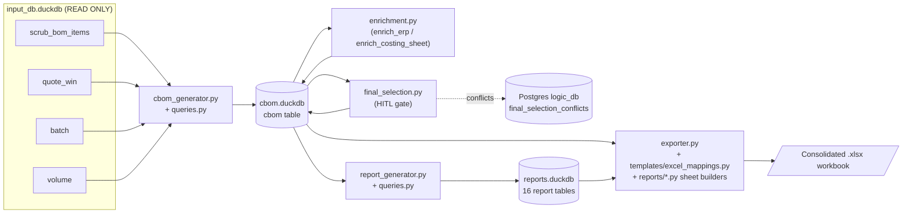

# Reporting Module

## Table of Contents

- [Overview](#overview)
- [Architecture](#architecture)
- [Top-level core pipeline files](#top-level-core-pipeline-files)
  - [mcp_server.py](#mcp_serverpy)
  - [reporting_pipeline.py](#reporting_pipelinepy)
  - [config.py](#configpy)
  - [database.py](#databasepy)
  - [schema.py](#schemapy)
  - [constants.py](#constantspy)
  - [cbom_generator.py](#cbom_generatorpy)
  - [enrichment.py](#enrichmentpy)
  - [final_selection.py](#final_selectionpy)
  - [report_generator.py](#report_generatorpy)
  - [exporter.py](#exporterpy)
  - [queries.py](#queriespy)
  - [currency.py](#currencypy)
  - [scrap_factor.py](#scrap_factorpy)
  - [helpers.py](#helperspy)
  - [migrations.py](#migrationspy)
  - [validator.py](#validatorpy)
  - [logging_utils.py](#logging_utilspy)
  - [excel_formatter.py](#excel_formatterpy)
  - [excel_formulas.py](#excel_formulaspy)
  - [enrich_issue_docs.py](#enrich_issue_docspy)
  - [test_currency.py](#test_currencypy)
  - [requirements.txt](#requirementstxt)
  - [README.md / WORKFLOW.md](#readmemd--workflowmd)
- [reports/ — the 16 report builders](#reports--the-16-report-builders)
- [templates/](#templates)
- [Test/validation artifacts (not documented in detail)](#testvalidation-artifacts-not-documented-in-detail)
- [Apache Superset Integration](#apache-superset-integration)
- [Related documents](#related-documents)

## Overview

`reporting_module` is a self-contained, "plug-and-play" DuckDB engine that
turns 4 already-populated input tables (`scrub_bom_items`, `quote_win`,
`batch`, `volume`) into a generated CBOM (Costed BOM), 16 business reports,
and one consolidated, production-formatted Excel workbook. It is exposed
to the rest of the platform exclusively through 6 FastMCP tools (see
`mcp_server.py` below) — nothing outside this module reaches into its
internals directly.

**Confirmed genuinely self-contained**: it imports only itself plus 4
external packages (`fastmcp`, `duckdb`, `pandas`, `openpyxl` — see
`requirements.txt`). It imports nothing from the parent `centum intake`
root — the coupling runs the other direction (`hitl_router.py` and
`duck_db_api.py` reach INTO this module via `sys.path` manipulation, not
the reverse — see
[Backend/file-reference.md](../Backend/file-reference.md)).

**This is a Python port of an original Laravel/PHP reporting engine.**
Nearly every file in `reports/` opens with "Python port of the `<X>` report
(Laravel PHP)" and names the exact PHP class/method it reproduces (e.g.
`aclass_parts()` ports `BlockthreeController::aclass_json()`). This is
stated directly in the source, not inferred — worth knowing when comparing
behavior against a reference/production workbook, since the intent is
byte-for-byte parity with that original system, not a redesign.

## Architecture

## Top-level core pipeline files

### mcp_server.py

**Purpose**: the module's only public surface — a FastMCP server named
`"cbom-reporting"`, registered in MCP Jungle as `centum_reporting` (so its
tool names appear as `centum_reporting__*`, matching
[Database/logic-database.md](../Database/logic-database.md)'s
`system_skills_registry` rows). Run directly for streamable-HTTP transport
on `192.168.1.27:8005`, or imported as `mcp` for in-process testing via
`fastmcp.Client(mcp)`.

**6 tools, each taking exactly one `rfq_id: str` parameter**, each a thin
try/except wrapper around `reporting_pipeline`/`exporter` that converts any
exception into `{"status": "failed", "rfq_id": ..., "error": str(e)}`
rather than letting it propagate as a raw exception:

| Tool | Delegates to | Notes |
|---|---|---|
| `cbom` | `reporting_pipeline.run_cbom` | Regenerates CBOM structure + `_qw` columns from `quote_win`. |
| `enrich_erp` | `reporting_pipeline.run_erp_enrichment` | Fills `_erp` columns. Currently unused in the active routing sequence (see [Database/logic-database.md](../Database/logic-database.md)), kept for future use. |
| `enrich_costing_sheet` | `reporting_pipeline.run_costing_enrichment` | Fills `_costing` columns. Independent of `enrich_erp` — either order, or either skipped. |
| `resolve_final_selection` | `reporting_pipeline.run_resolve_final_selection` | The HITL gate — see below. |
| `generate_reports` | `reporting_pipeline.run_pipeline` | Regenerates all 16 reports from whatever CBOM data currently exists. |
| `export_reports` | `exporter.export_excel` | Read-only export to a single `.xlsx`. |

Both `enrich_*` and `resolve_final_selection` require `cbom` to have
already run (they raise if no rows exist). `resolve_final_selection`'s own
docstring is explicit about *why* it never returns row-level conflict data
through the MCP response: "an RFQ can have thousands [of conflicting
rows]... see hitl_router.py for how a human reviews/resolves them via
paginated endpoints, not through this tool." When its response has
`"hitl": 1`, the caller (`fastapi_router.py`) must not advance the routing
sequence until every pending conflict is resolved (see
[DMR/dynamic-master-router.md](../DMR/dynamic-master-router.md)).

### reporting_pipeline.py

**Purpose**: the top-level orchestrator — one function per MCP tool above
(`run_cbom`, `run_erp_enrichment`, `run_costing_enrichment`,
`run_resolve_final_selection`, `run_pipeline`), each independently
transactional (`BEGIN`/`COMMIT`/`ROLLBACK` around its own `database.connect()`
connection) and each returning a structured summary dict
(`status`, `rfq_id`, `execution_time_seconds`, row counts, warnings).

**Key behaviors, confirmed by reading the source directly**:
- `run_cbom`: wraps `cbom_generator.clear_cbom_rfq` (a `DELETE ... WHERE
  rfq_id = ...`) + `cbom_generator.generate_cbom` in one transaction — a
  regenerate is delete-then-insert, not an upsert.
- `run_erp_enrichment` / `run_costing_enrichment`: require `cbom` rows to
  already exist for the `rfq_id` (raise `ValueError` otherwise, with an
  explicit "call the cbom tool first" message).
- `run_resolve_final_selection`: same precondition, plus logs
  `hitl=<value> pending_conflicts=<count>` on success.
- `run_pipeline` (backs the `generate_reports` tool): does **not**
  regenerate CBOM. Clears + regenerates all 16 report tables in one
  transaction; if `report_generator.generate_reports()` reports any
  `issues`, the WHOLE transaction is rolled back rather than committing a
  partial set of 16 tables — confirmed via an explicit `raise RuntimeError`
  on non-empty `issues`.

### config.py

**Purpose**: "the ONE file to touch when copying `reporting_module/` into
a different project" (its own docstring, verbatim). Resolves 3 DuckDB file
paths — `INPUT_DB_PATH`, `CBOM_DB_PATH`, `REPORTS_DB_PATH` — defaulting to
a shared `../database/` folder (one level up from this file), each
independently overridable via environment variables
(`REPORTING_INPUT_DB`, `REPORTING_CBOM_DB`, `REPORTING_REPORTS_DB`, or the
whole directory via `REPORTING_DATABASE_DIR`). Also resolves `EXPORTS_DIR`
and `LOGS_DIR` (both under this module's own folder by default,
`REPORTING_EXPORTS_DIR`/`REPORTING_LOGS_DIR` overridable), creating both
directories on import if missing.

**Critical, confirmed-in-practice caveat**: when this module is copied to
a location where "one level up" is no longer the right database folder
(exactly what happened migrating it into
`BuLLMQuote-SRIM\mcp-tools\reporting\superset\`, 3 levels deep instead of
1), the default silently resolves to a nonexistent path rather than
erroring immediately — see [Database/logic-database.md](../Database/logic-database.md)
and [Deployment/deployment.md](../Deployment/deployment.md) for the
concrete fix (`REPORTING_DATABASE_DIR` override) applied in that specific
case.

### database.py

**Purpose**: the single place that opens all 3 databases — "the
load-bearing guarantee that `input_db.duckdb` is NEVER opened for writing
by this module" (its own docstring). Every other file that needs a
DuckDB connection goes through this module's `connect()`.

**`connect()`**, in order:
1. Opens `reports.duckdb` as the main catalog.
2. `ATTACH cbom.duckdb AS cbom_db` (read-write — this module's own
   generated artifact).
3. `ATTACH input_db.duckdb AS input_db (READ_ONLY)` — the 4 input tables
   are prepared once by `migrations.py`/an external loader, never by this
   module.
4. Runs a series of **idempotent, self-healing schema migrations** inline
   on every connection (not a separate migration step): retypes
   `cbom.volume_no`/`cbom_vl_report.volume_no` from `SMALLINT` to
   `VARCHAR` (needed to hold the literal string `"proto"` alongside
   numbered volumes), retypes `line_no` columns from `INTEGER` to
   `VARCHAR` (needed to hold `"Line_{n}"`-style values), and adds a
   `hierarchy_multiplier DOUBLE` column to both `cbom` and
   `cbom_vl_report` if missing.
5. Runs every `CREATE TABLE IF NOT EXISTS` in `schema.py`.

**Why a full table rebuild (not a plain `ALTER COLUMN TYPE`) is needed for
`volume_no` specifically**: DuckDB (as of 1.5.3, per the code's own
comment) refuses to retype a column that's part of a `UNIQUE`/`PRIMARY
KEY` constraint. `_rebuild_table_with_new_ddl()` works around this by
renaming the old table aside, recreating it fresh from its own up-to-date
`CREATE TABLE` DDL, copying every row across (`INSERT ... SELECT`, which
DuckDB implicitly widens `SMALLINT`→`VARCHAR` for), then dropping the
renamed-aside original. `line_no` and the `hierarchy_multiplier` addition
don't have this problem (not part of a constraint), so they use a plain
`ALTER TABLE ... ALTER COLUMN` / `ADD COLUMN` instead.

**Column-count alignment note** (confirmed real, from an inline comment):
`cbom_vl_report`'s `hierarchy_multiplier` column must be added at the same
relative position as `cbom`'s own, because `queries.py`'s
`report_insert_sqls()["cbom_vl_report"]` does a bare positional `INSERT
INTO cbom_vl_report SELECT * FROM cbom_db.cbom` — this failed for real
once with `"table cbom_vl_report has 78 columns but 79 values were
supplied"` before this alignment was enforced.

### schema.py

**Purpose**: DuckDB table DDL for `cbom.duckdb` (`CBOM_DDL`) and
`reports.duckdb` (`REPORT_DDLS`, a dict of 16 `CREATE TABLE IF NOT EXISTS`
statements, one per report). Both are "our own generated artifacts, freely
evolvable" (its own docstring) — unlike the input tables, which this
module never creates. `cbom`'s DDL includes the confirmed real column
naming convention: `_costing`/`_erp`/`_qw` suffixes for the 3 pricing
sources, `final_*` for the resolved value.

### constants.py

**Purpose**: 2 pure data constants — `REPORT_ORDER` (the fixed processing
order for all 16 reports, also used by `report_generator.clear_reports_rfq`
to delete in a consistent order) and `SHEET_NAMES` (DuckDB table name →
Excel tab name mapping, which also defines the exported workbook's tab
order: CBOM first, then this module's own added raw-CBOM tab, then the 16
reports in the original production workbook's own tab order, then one
"7.0 CBOM VL-{n}" / "Ex Inv VL-{n}" pair per detected volume).

### cbom_generator.py

**Purpose**: thin orchestration around the CBOM generation SQL (the actual
business logic lives in `queries.py`). `clear_cbom_rfq(con, rfq_id)` is a
plain `DELETE`. `generate_cbom(con, rfq_id)` first checks `scrub_bom_items`
has rows for this `rfq_id` (raises `ValueError` if not — "call this before
that" preconditions are a consistent pattern across every stage in this
module), then builds and runs the insert, returning row-count/
priced-row-count/detected-volumes for the caller's summary.

### enrichment.py

**Purpose**: thin orchestration for the `enrich_erp`/`enrich_costing_sheet`
tools, mirroring `cbom_generator.py`'s shape. `_require_cbom_rows()` is a
small shared precondition helper both `enrich_erp`/`enrich_costing_sheet`
call before doing anything — same "cbom must exist first" pattern as
`reporting_pipeline.py`'s own guards (redundant with them, defense in
depth at two layers).

### final_selection.py

**Purpose**: auto-resolves CBOM rows where exactly one pricing source
(`_costing`/`_erp`/`_qw`) has data, and persists genuine multi-source
conflicts to **Postgres** `logic_db.final_selection_conflicts` for human
review — the only file in this module that talks to Postgres at all
(everything else is pure DuckDB). Also defines
`recompute_derived_columns` — the shared function both this module's own
resolution path AND `duck_db_api.py`'s `PUT /api/bom/batch-update/{rfq_id}`
(see [APIs/endpoints.md](../APIs/endpoints.md)) call after any edit to
`final_*` columns, keeping `is_costed`/`scrap_percent`/`abc_classification`
always in sync with whatever `final_price_conv` currently is.

**Why Postgres, not DuckDB, for the conflict table** — quoted from the
module's own docstring, since the reasoning is precise and worth
preserving verbatim: *"it is workflow/human-review state (who's reviewing
what, what's been decided), not analytical CBOM data... Postgres...gives
proper concurrent-writer support for multiple reviewers, real transactional
guarantees, and keeps auditing where the rest of the orchestration state
already lives. DuckDB (cbom.duckdb) stays the system of record for CBOM
values only — it receives writes solely for final, decided values...never
the in-progress review state itself."*

**Never returns row-level conflict data through the MCP response** — an
RFQ can have thousands of conflicting rows, and (per the module's own
docstring) "the MCP → FastAPI → Dify chain cannot carry that as one
payload." This is why `hitl_router.py` exists as a separate, dedicated
paginated API (see
[Backend/file-reference.md](../Backend/file-reference.md#hitl_routerpy)
and [APIs/endpoints.md](../APIs/endpoints.md)) rather than the conflict
data flowing back through this tool's own response.

### report_generator.py

**Purpose**: thin orchestration loop that clears (`clear_reports_rfq`, in
`constants.REPORT_ORDER`) and regenerates all 16 report tables from the
already-generated `cbom` table (plus, for a few reports, the raw input
tables directly). Business logic (the actual SQL) lives in `queries.py`.

### exporter.py

**Purpose**: the final, read-only export stage. Explicitly documented as
never regenerating data — "that's cbom_generator.py's/report_generator.py's
job." Its own job, per its docstring: (1) load the RFQ-scoped DuckDB rows,
(2) reshape them via `templates/excel_mappings.py` into each report's
expected payload, (3) dispatch into the 16 `build_*_sheet()` functions in
`reports/*.py` in the right order, (4) save the workbook. **No styling or
formula logic is duplicated here** — it's a pure dispatcher.

`_build_cbom_raw_sheet()` is this module's own addition (not present in
the original production workbook, which only has the per-volume "7.0 CBOM
VL-{n}" sheets) — a plain literal-value dump of the combined,
across-all-volumes `cbom` data, styled consistently with the other sheets
but with no cross-sheet formulas (since a table spanning every volume at
once has no single-volume sheet to reference).

### queries.py

**Purpose**: "SQL-building functions for the CBOM insert, the erp/
costing_sheet enrichment updates, the QuoteWin tie-break view, the Ex Inv
VL calculation view, and all 16 report inserts" (its own docstring).
Every function returns a SQL string (or list/dict of them) — nothing here
executes a query; that's `database.py`'s/`cbom_generator.py`'s/
`enrichment.py`'s/`report_generator.py`'s job. Centralizing the SQL text
here, separate from control flow, is explicitly stated to make it "easy to
audit exactly what each report/column computes."

**Confirmed real data-quality safeguard**: every `quote_win`/
`costing_sheet` part-number join is deliberately case-insensitive
(`UPPER()` on both sides) — the docstring notes real observed casing drift
between sources (e.g. `costing_sheet.part_number` arriving all-uppercase
while `scrub_bom_items.cpn` keeps its original mixed case) that would
silently drop matching rows under an exact-case join with no error
surfaced.

**Historical note, confirmed in-source**: the current 3-stage split
(`cbom` → `enrich_erp` → `enrich_costing_sheet`, each its own MCP tool)
replaced an earlier single do-everything INSERT and a since-retired
`cbom_enrichment.py` script (now at
`centum intake\deprecated\cbom_enrichment.py.deprecated`).

### currency.py

**Purpose**: single source of truth for currency conversion rates and the
default quote currency, backed by **Postgres**
`logic_db.currency_conversion_rates`/`currency_settings` (managed via
accomplish-ui's Settings → Currencies admin UI — see
[Frontend/accomplish-ui.md](../Frontend/accomplish-ui.md)). Confirmed real
consolidation: previously 8 separate files (this module's own earlier
version, `queries.py`'s `_rate_case()`/`_to_usd_sql()`,
`templates/excel_mappings.py`, and 6 individual report files) each
independently hardcoded the same `{"USD": 1.0, "INR": 83.5, "EUR": 0.93}`
mapping — changing a rate meant editing 8 places. Now every one of those
reads through this module.

**Caching**: rates are cached for the lifetime of one pipeline run (these
functions are called per-row, potentially thousands of times per report —
querying Postgres on every call would be too slow). `clear_cache()` exists
for a long-lived process/notebook where rates might change mid-session.

### scrap_factor.py

**Purpose**: same consolidation pattern as `currency.py`, for Scrap Factor
tier configuration, backed by Postgres `logic_db.scrap_factor_settings`.
Confirmed real business rule (stated explicitly and precisely in the
source, worth preserving exactly): **Min Price is INCLUSIVE, Max Price is
EXCLUSIVE** (a price of exactly 1.25 is Class A, not B — a deliberate
correction from an earlier strict `> 1.25` comparison). A component with
`NULL` price gets no Scrap Class at all (not a silent default); a price of
exactly `0` is a genuinely valid price and correctly falls into Class C
(not treated as "missing"). The generated workbook also gets a hidden
"Scrap Factor" sheet (`reports/cbom_vl.py`'s `build_scrap_factor_sheet()`)
populated from this exact same table, with CBOM VL-1's own ABC
Classification/Scrap columns doing live Excel `INDEX`/`MATCH` lookups
against it instead of a static backend-computed value — "so the sheet, the
SQL, and the Python-side MOQ cost math all agree by construction, not by
convention" (source comment, verbatim).

### helpers.py

**Purpose**: small, generic, no-business-logic utilities shared across the
module: `sql_quote()` (SQL string-literal quoting via quote-doubling),
`slugify()` (filesystem/Excel-sheet-safe filename slugs), `excel_safe()`
(converts a value to something openpyxl's `Cell.value` setter accepts —
handling pandas/NumPy NA sentinels).

### migrations.py

**Purpose**: **one-time, additive** schema migrations for `input_db.duckdb`
— explicitly NOT part of the `generate_reports()`/`export_reports()` call
path, never invoked automatically. The ONLY file in this module that ever
opens `input_db.duckdb` for writing (everywhere else attaches it strictly
read-only, per `database.py`'s own guarantee). Run manually
(`python migrations.py`) once against a freshly-loaded `input_db.duckdb`
that has the 4 input tables but not yet the extra columns this reporting
engine requires (`rfq_id` on all 4 tables, `display_order` for CBOM VL's
Recurring Count). Both migrations are idempotent and additive-only
(never delete/overwrite existing data), and both assert row counts are
unchanged before/after as a hard safety check (`raise SystemExit` if
violated).

### validator.py

**Purpose**: formalizes ad-hoc development-time checks into one reusable
`validate_rfq(con, rfq_id)` function. Deliberately **not** wired into
`generate_reports()`/`export_reports()` automatically ("those stay fast
and side-effect-free" — its own docstring) — meant to be called explicitly
as a health check or CI/smoke-test step. Every check is read-only.

### logging_utils.py

**Purpose**: single shared `logger` (name `"cbom_reporting"`) for every
stage in this module. File-handler only (writes to
`config.LOGS_DIR/report_generation.log`), deliberately no console handler
— "stays quiet in a consuming application unless that application also
attaches its own handler to this same logger name."

### excel_formatter.py

**Purpose**: generic worksheet-styling helpers (`autosize_and_freeze()`,
frozen header row styling) used ONLY by `exporter.py`'s own raw "CBOM" tab.
Explicitly NOT used by the 16 report tabs in `reports/*.py` — those
already carry their own local styling, independently verified byte-for-byte
against the reference production workbook, and are deliberately left
un-refactored to avoid touching already-tested code for a purely cosmetic
consistency gain (see the module's own README "Design boundary" section).

### excel_formulas.py

**Purpose**: number-format application (money at 4 decimals, percentages)
for the raw "CBOM" tab only — same "Design boundary" as
`excel_formatter.py` above. The actual live Excel FORMULA strings for the
16 report tabs (e.g. CBOM VL's Is Price Same/Is MPN Same/Batch Qty
overlays) live inside `reports/cbom_vl.py` itself, alongside the sheet
structure (column positions, row ranges) that only that module's own
row-building logic knows — deliberately not factored out into a generic
formula-string factory here, since doing so "would mean passing that same
sheet-structure context right back in through this file's API, without
saving any real duplication" (source comment, verbatim).

### enrich_issue_docs.py

**Purpose**: a documentation/tooling utility, not part of the runtime
pipeline. Post-processes batch validation results with confirmed
root-cause/suggested-fix text (derived from direct investigation of real
failures, per its own docstring — "not guessed"), and rewrites each test
folder's `issues_found.md` plus `master_test_summary.md`. Does not re-run
the pipeline itself.

### test_currency.py

**Purpose**: unit tests for `currency.py`, using the standard library's
`unittest` (not pytest — its own docstring notes "this project has no
existing unit-test framework/convention to build on"). Run via
`python -m unittest test_currency -v`.

### requirements.txt

4 declared dependencies: `fastmcp`, `duckdb`, `pandas`, `openpyxl` —
confirms this module's genuine self-containment claim (no dependency on
anything in the parent `centum intake` root's own dependency set).

### README.md / WORKFLOW.md

`README.md`: setup/configuration/day-to-day usage documentation — "copy
the whole folder into another project, point `config.py` at your own data...
and it works with no other code changes" is this module's own stated
design goal (directly consistent with
[Architecture/design-principles.md](../Architecture/design-principles.md)'s
"Modular Architecture" principle — this is a second, independent piece of
real evidence for that principle, alongside the two dormant MCP tool
servers). `WORKFLOW.md`: the full business/technical explanation of what
happens at each pipeline stage — the deeper companion to this document's
own architecture summary above.

## reports/ — the 16 report builders

Every file in this folder follows the same 2-layer (occasionally 3-layer)
pattern, confirmed consistently across all 16: a pure-Python `compute`
function (ports a specific Laravel `BlockthreeController::*`/similar
method, producing the exact JSON payload shape the original PHP system
persisted) plus a `build_*_sheet()` function (ports the matching Laravel
`*ExportExcelFormula.php`/`*Export.php` class, writing the actual Excel
worksheet — often with **live Excel formulas**, not static values, where
the original production workbook itself is formula-driven).

| File | Excel sheet | Compute function | Notes |
|---|---|---|---|
| `bom_matrix.py` | "BOM Matrix" | (payload provided externally, not computed here) | Live-formula-only port — cells reference OTHER sheets ("7.0 CBOM VL-{n}", "Ex Inv VL-{n}") that must already exist in the same workbook. |
| `part_num_vs_mfg_num.py` | "Part Num Vs Mfg Num" | `part_num_vs_mfg_num()` | Ports `BlockthreeController::cpnvsmpn_json()`. |
| `pcb_nre_fai_charge.py` | "PCB NRE & FAI Charge" | `fai_charge_rows()` | Ports `BlockthreeController::faiCharge()`; header + one row per costed PCB CPN+MPN pair + placeholder row if none qualify + trailing total. |
| `mech_em_nre.py` | "Mech & EM NRE" | `mech_em_nre_rows()` | Ports `BlockthreeController::nrecharge()`. |
| `missing_notes.py` | "Missing Notes" | `missing_notes()` / `flatten_missing_notes()` | Ports `MissingNotesController::missingNotes()`; 14 sections, a section only included if it found ≥1 match. |
| `lead_time_fg.py` | "Lead Time (FG Wise)" | `lead_time_fg_blocks()` / `flatten_lead_time_fg()` | Ports `BlockthreeController::lead_time_fg()`; per-FG lead-time buckets. 3-layer (compute → flatten → build). |
| `lead_time_consolidated.py` | "Lead Time Consolidated" | `lead_time_consolidated_rows()` | Ports `BlockthreeController::lead_time_consolidate()`; BOM-wide rollup, no FG grouping (unlike the FG-wise variant). |
| `sum_and_count.py` | "Sum & Count" | (pure transform of an upstream payload) | Ports `BlockthreeController::sum_and_count()`. |
| `sum_and_count_detailed.py` | "Sum & Count Detailed" | (pure transform of an upstream payload) | Ports `BlockthreeController::sum_and_count_detail()`. |
| `revision_history.py` | "Revision History" | `revision_history_rows()` | Ports `BlockthreeController::revision_history_json()`; Old vs. New revision comparison per CPN per volume. |
| `aclass_parts.py` | "A CLASS PARTS" | `aclass_parts()` | Ports `BlockthreeController::aclass_json()`; per-CPN ABC cost rollup. This session's own earlier work (dual-role structural CPN fix, `_effective_structural_fg_cpns()`) touches this file's row-inclusion logic — see the fix's own inline comments for the full history. |
| `price_control.py` | "Price Control" | `price_control()` | Ports `PriceControlController::processPriceControl()`; buckets parts into Centum/Customer at the single last-quoted volume. Live `SUMPRODUCT` formulas in the built sheet. |
| `summary.py` | "Summary" | `summary()` | Ports a collapsed (non-chunked) version of `Tab8Context`/`Tab8Computer::computeRevisionPartial()`/`Tab8Merger::mergeAndPersist()` — the original PHP chunks CPNs into groups of 200 for parallel queue processing purely for performance; this port computes the whole revision in one Python pass with mathematically identical results. This sheet's own "CBOM Cost" column does a live `INDEX`/`MATCH` directly into "7.0 CBOM VL-{n}"'s own Assembly Summary total, per this session's earlier CBOM-formula work. |
| `batchwise_cashflow.py` | "Batchwise Cashflow" | `batchwise_cashflow_rows()` | Ports `BatchwiseCashflowExportExcelFormula::array()`; proto section first, then volume sections sorted ascending. |
| `cbom_vl.py` | "7.0 CBOM VL-{n}" (one per volume) | `cbom_vl_rows()` | Ports `CBOMVolumeSheetExcelFormula::generateRows()`. **The most extensively worked-on file in this module this session** — the "Is Assembly" flag fix, the hierarchy_multiplier-aware Assembly Summary total (a new "FG Ext Price (Conv.)" helper column, AX), and the dual-role structural CPN fix all live here; also owns the Batch Settings/Scrap Factor hidden-sheet builders (`build_batch_settings_sheet`, `build_scrap_factor_sheet`) and the live-formula overlays for Price (Splits), Ext Price, Batch Qty, Is Assembly, ABC Classification/Scrap. See this file's own extensive inline comments for the full reasoning behind each fix — they are unusually detailed and are the authoritative source, more so than any external summary. |
| `ex_inv_vl.py` | "Ex Inv VL-{n}" (one per volume) | `ex_inv_vl_rows()` | Ports `ExcessInventoryVolumeSheetExcelFormula::array()`. Unlike most ports in this module, nearly every cell besides Part Number/Excess In Stk IS a live Excel formula referencing the matching "7.0 CBOM VL-{volume}" sheet — formula generation IS this report's actual output, not an enhancement layered on top of static values. |

## templates/

### excel_mappings.py

**Purpose**: reshapes RFQ-scoped DuckDB rows (`cbom` + the 4 input tables)
into the exact payload shapes each of the 16 `reports/*.py` compute
functions already expect. **No business logic here** — pure reshaping, so
the already-validated compute/build functions run unchanged regardless of
how the underlying DB schema evolves. Confirmed unchanged from a
pre-refactor `excel_export_adapters.py` module — only the file's name and
package location moved, not its logic.

**Stated rule of thumb** (its own docstring): prefer sourcing every field
from `cbom` directly (it already carries merged Scrub BOM + Quote Win
fields per row); fall back to raw `scrub_bom_items`/`quote_win` only for
the handful of fields `cbom` doesn't carry (Part Status, No Bid Reason,
Exp Date for Missing Notes specifically).

This file also contains `fg_part_qty_sums()`, `_build_hierarchy_multipliers()`-
adjacent helpers, and `_effective_structural_fg_cpns()` (the Python-side
mirror of `cbom_vl.py`'s own "Is Assembly" Excel-formula logic, used by
`to_bom_matrix_payload()`/`to_aclass_parts_payload()` to decide row
existence before any Excel formula exists to filter on) — all from this
session's earlier CBOM-accuracy work; see `cbom_vl.py`'s own inline
comments (referenced above) for the complete reasoning.

### excel_styles.py

**Purpose**: shared openpyxl style constants (navy header fill, light-blue
data fill) for sheets this module builds directly — currently only
`exporter.py`'s raw "CBOM" tab. The 16 report tabs already carry their own
local, independently-verified style constants and are deliberately NOT
repointed at this shared file, "to avoid touching already-tested,
already-verified code for a cosmetic consistency gain" (its own "Design
boundary" note, referenced by `excel_formatter.py` and
`excel_formulas.py` too).

### formula_templates.py

**Purpose**: 2 reusable Excel number-format strings (`MONEY_FORMAT`,
`PERCENT_FORMAT`), applied by `excel_formatter.py` to the raw "CBOM" tab
only — same "Design boundary" as above; the 16 report tabs already set
their own number formats locally.

## Test/validation artifacts (not documented in detail)

Not part of the runtime pipeline; mentioned briefly for completeness:
- `_batch_validate_raw_result.json`, `batch_validate_run4.log` — raw
  output from a batch validation run (`batch_validate_all_tests.py`,
  documented in [Backend/file-reference.md](../Backend/file-reference.md)
  since it lives partly at the `centum intake` root's own test tooling
  level conceptually, though the file itself is inside this module).
- `ref_sumcount_detailed.pkl` — a cached reference dataset used by some
  validation script, not consumed by the production pipeline itself.
- The 3 local `.duckdb` files that exist in this folder on disk
  (`cbom.duckdb`, `input_db.duckdb`, `reports.duckdb`) are **confirmed
  stale** — a different, older, much smaller dataset than the real ones
  this module's `config.py` actually resolves to (in the shared
  `centum intake\database\` folder by default). Not documented as
  meaningful data; see
  [Database/logic-database.md](../Database/logic-database.md) and
  [Deployment/deployment.md](../Deployment/deployment.md) for the full
  finding.

## Apache Superset Integration

**No direct Superset integration code or configuration exists inside this
module.** Searched `reporting_module`'s own source and its `README.md`/
`WORKFLOW.md` for any Superset-specific code (API calls, dataset
definitions, dashboard config) — none found. This module's actual role in
the reporting/analytics story is purely as a **data producer**: it writes
`reports.duckdb`/`cbom.duckdb`, which Superset (an external BI tool,
installed separately at `C:\Superset\`) is pointed at as a data source,
and which `duck_db_api.py`/`bom_qa_lookup_server.py` also read directly
for API access (see [Backend/file-reference.md](../Backend/file-reference.md)
and [APIs/endpoints.md](../APIs/endpoints.md)). The actual Superset
embedding UI code lives entirely in `accomplish-ui`'s `apps/web`
(`@superset-ui/embedded-sdk`) and `apps/daemon` (`superset-client.ts`,
guest-token minting) — see
[Frontend/accomplish-ui.md](../Frontend/accomplish-ui.md#appsdaemon--the-backend-for-frontend).
If a future integration were added directly to this module (e.g. a
Superset dataset-refresh trigger fired from `export_reports`), it would
belong here, but no such thing exists today — stated plainly rather than
inferring an integration that isn't present.

## Related documents

- [MCP/fastmcp-tools.md](../MCP/fastmcp-tools.md) — this module's 6 tools in the cross-cutting tool inventory
- [Database/logic-database.md](../Database/logic-database.md) — the DB-path resolution caveat when this module is relocated
- [Deployment/deployment.md](../Deployment/deployment.md) — the specific migration into `mcp-tools/reporting/superset/` and its fix
- [Backend/file-reference.md](../Backend/file-reference.md) — `hitl_router.py`/`duck_db_api.py`, which reach into this module
- [Frontend/accomplish-ui.md](../Frontend/accomplish-ui.md) — the Superset embedding UI, the other half of the reporting story
- [DeveloperGuide/getting-started.md](../DeveloperGuide/getting-started.md) — the blank-guard formula pattern and config.py name-collision issue, both rooted in this module
